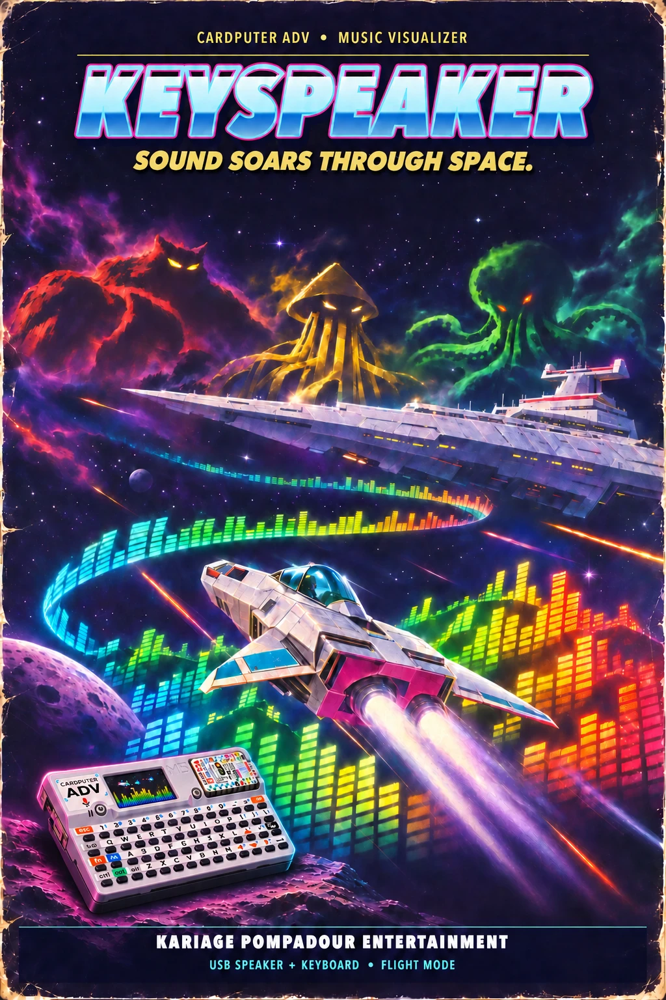
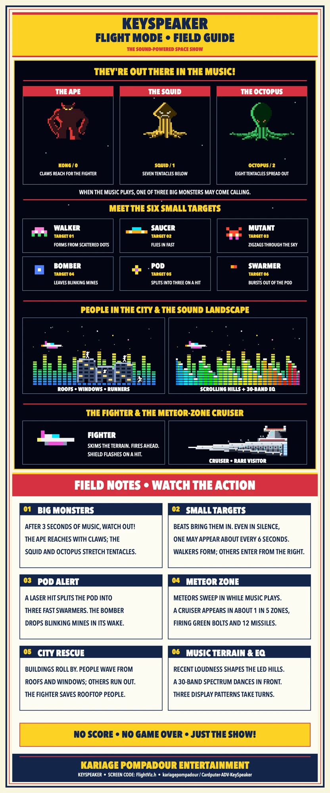
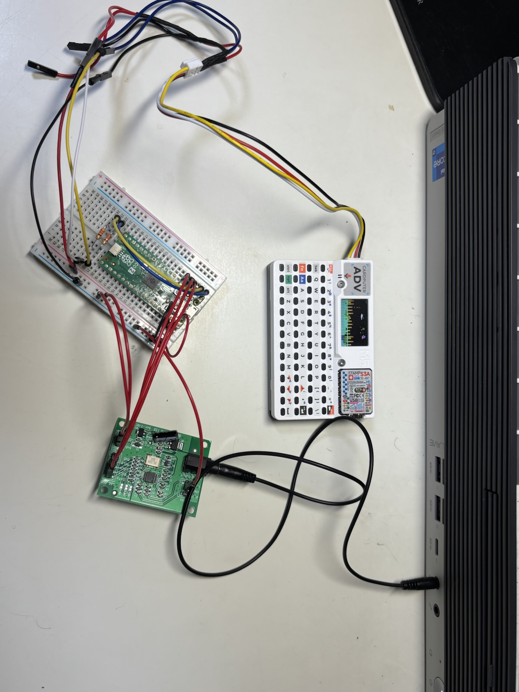
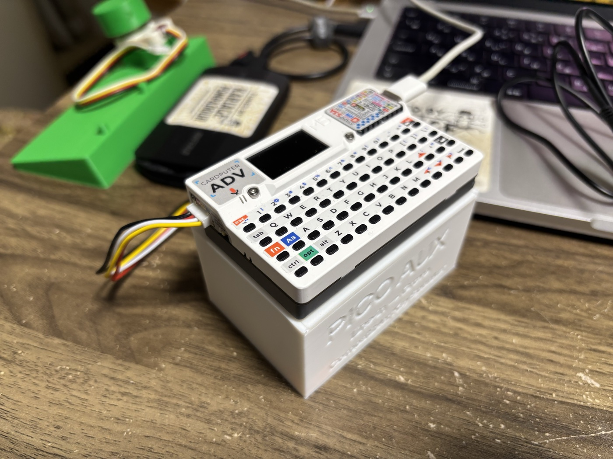
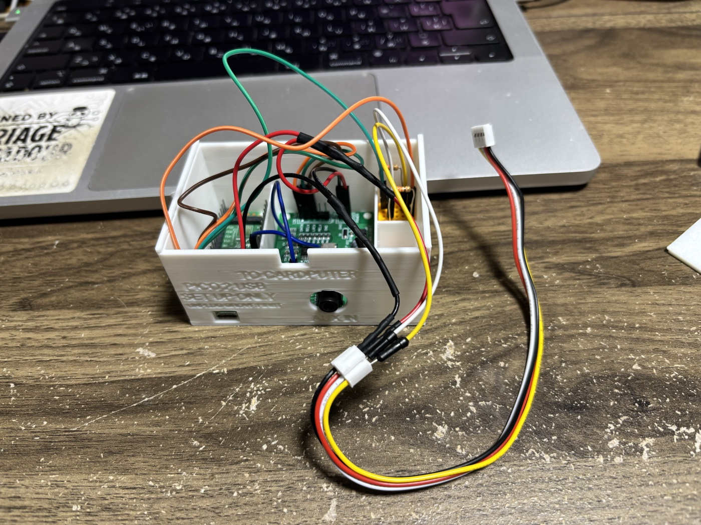
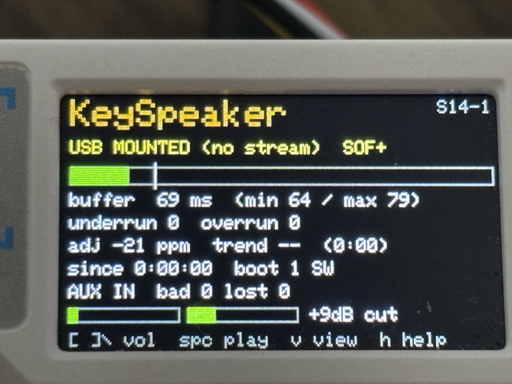

# KeySpeaker

### USB Speaker & BLE Keyboard for M5Stack Cardputer ADV

**A pocket speaker and keyboard for your computer, phone or console. Keep it in your bag.**

<table>
<tr>
<td valign="top" width="480">

[日本語版 README](README_JA.md)

</td>
<td valign="top" width="360">

</td>
</tr>
</table>

> **Status: in development.** On a Mac and on Windows 11, one USB-C cable now gives you both: the speaker plays at
> a good level (8 hours without a dropout, pause and resume work) and the keyboard types, with volume and playback keys.
> An iPhone 15 works over USB too, and the tilt mouse works. As a spare, unplugged it is a Bluetooth LE keyboard and
> mouse (working on a Mac and on Windows 11; going back to USB needs the power switch off and the reset button). Firmware: [`firmware/KeySpeaker_S0/`](firmware/KeySpeaker_S0/).
> Design: [`docs/DESIGN.md`](docs/DESIGN.md). Test plan and results: [`docs/S0_TEST.md`](docs/S0_TEST.md).

## The idea

While building [RADIO DAYS SDR](https://github.com/kariagepompadour/RADIODAYS-SDR), I noticed that the Cardputer
ADV's built-in speaker sounds better than expected: good enough for background music, news, internet radio,
podcasts and the sound of videos. The Cardputer ADV also has a physical keyboard. So why not use both at the same
time?

## What it will do

- **Plug in a USB-C cable (the main way to use it):** the Cardputer ADV becomes a speaker and a keyboard, over one
  cable.
- **Unplug it (a spare):** it becomes a Bluetooth LE keyboard and mouse by itself, a few seconds later.
- **Nothing to install on the other device.** Only KeySpeaker goes onto the Cardputer, through a launcher or
  M5Burner ([Install](#install)).
- **A Cardputer ADV and a USB-C cable are all you need.** Everything on this page works with just those: the speaker,
  the keyboard, the tilt mouse and the flight mode. The Pico 2 AUX unit, its 3D-printed box and the jog dial are
  optional extras (see [Hardware](#hardware)). No soldering, no 3D printer.

Limits of the Bluetooth LE spare:

- **Going back to USB:** after an unplug, plugging the cable in again is not recognized. With the cable in, switch
  the power off and press the reset button. The keyboard screen says `Off+Reset to USB`.
- **Switching apps:** a computer paired in [Media Jog](https://github.com/kariagepompadour/Cardputer-ADV-Media-Jog)
  has to be removed and paired again for KeySpeaker, and the other way round (seen on a Mac).
- One computer at a time, and at most 2 paired computers.

Ways to use it:

- On a computer without speakers (a desktop PC, a Mac mini, a monitor).
- On a device that can send audio out of its USB-C port: a phone, a tablet, a digital audio player, a game console.
- Away from the cable, as a spare Bluetooth LE keyboard and mouse (checked on a Mac and on Windows 11).
- As a **USB-C earphone adapter**: plug earphones into the Cardputer's jack (mono: both ears get the same sound).

The keyboard is small: it is meant for short entries (a search box, a password field, a console's text screen), not
long texts.

## Modes and keys

<table>
<tr>
<td valign="top" width="480">

At start, KariPom's emblem on a speaker grille and the name "KeySpeaker" show for 2 seconds. `Fn+M` then cycles
through three modes (over USB); the last one is remembered. In measure mode, after a minute with no
key and no sound, the emblem comes back with `h HELP  Fn+M KEYBOARD` at the bottom, and stays until you press a key
(that key only wakes it). Flight mode stays as it is, to be watched. When music starts again, the emblem shakes on the loud beats, like a speaker's cone.
Pictures of every screen: [`docs/SCREENS.md`](docs/SCREENS.md).

- **measure mode**: Buffer, clock drift, volume and level meters. Keys: Speaker and playback keys (below)
- **flight mode**: A flight over the music: the volume as terrain, a little fighter, a Showa-era graphic equalizer, and now and then a space monster that reaches for the fighter. Keys: Speaker and playback keys (below)
- **keyboard mode**: A slowly spinning Earth and a key cheat sheet. Keys: Every key goes to the computer

  
  
  

*On the device, from left: measure mode, flight mode, keyboard mode.*

*Flight mode on the device, 3 seconds (recorded on an earlier build, which still showed the status line at the top).*

**Meteor zone:** every few minutes while music plays, the terrain sinks low and meteors stream from right to left. The fighter stops firing and weaves through them. The louder the music, the more meteors.

</td>
<td valign="top" width="360">

</td>
</tr>
</table>

Without USB (over Bluetooth LE), the keyboard screen is shown first; `Fn+M` then moves to the other screens.

**Microphone input (`Fn+I`):** the built-in microphone listens to the sound around you and moves the screen (the fighter, the
terrain, the equalizer). Nothing is played, so the speaker is silent. It works without USB, and `-` / `=` set the sensitivity
(the default is usually enough). While it is on, a green `MIC` shows at the bottom left of the keyboard screen. The green `USB`
there only says the cable is connected.

**AUX input (`Fn+I`):** with the optional Pico 2 AUX unit on the Grove port, sound from a computer's earphone jack or any other
player comes out of the Cardputer's speaker. The unit runs on the Cardputer's power and can stay connected. See the
[build guide](docs/AUX_PICO2_BUILD.md) and the [design](docs/AUX_PICO2_DESIGN.md).

The author's build. The extra wires on the Grove cable are from an earlier project. Follow the figures and tables, not this photo.

The same unit in a 3D-printed box, with the Cardputer ADV snapped onto the lid (the [STL files](hardware/aux-pico2-box) and the [box notes](docs/AUX_PICO2_BOX.md)). Right: the data screen in AUX mode, `AUX IN bad 0 lost 0`.

  
  
  

**MP3 input (`Fn+I`):** put `.mp3` files in a `/music` folder on a microSD card (or in its top folder) and the Cardputer plays them
as a fourth input, with the same screens: the fighter and the flight view follow the music. It also plays without a computer (on the battery, a power bank or a plain USB
charger): choose it with `Fn+I` within 10 seconds of switching on, before the Bluetooth keyboard starts, and the next start without a computer
begins with MP3 again (with USB it always starts with USB). While MP3 plays the Bluetooth keyboard is off. Once the Bluetooth keyboard has started,
MP3 needs the power switched off and on (the Bluetooth stack takes most of the memory and cannot be released), and the screen says `RESTART`.
On battery alone, MP3 played for 10 hours without a break and was still playing when the test was stopped (2026-11-14, S16-10, 10 tracks on repeat, screen on: underrun 0, overrun 0, no restart). On the measure and flight screens, `Space` pauses or plays, `,` goes to the previous track and
`/` to the next; the tracks loop. MP3 layer 3, 32 / 44.1 / 48 kHz, stereo or mono, up to 320 kbps. Details: [docs/MP3_DESIGN.md](docs/MP3_DESIGN.md).
The decoder is [minimp3](https://github.com/lieff/minimp3) (CC0, public domain; see [docs/MP3_LICENSE.md](docs/MP3_LICENSE.md)).

Each press of `Fn+I` moves on to the next input: USB, MIC, then AUX when the unit is there, then MP3. The fighter crosses the screen and
leaves the input in big letters behind it, or `NO USB`, `NO AUX`, `NO SD`, `NO MP3` or `RESTART` in red when that source is missing.

In every mode:

| Key | Does |
| --- | --- |
| `Fn+M` | Next mode (works without USB too) |
| `Fn+I` | Input: USB sound, the built-in microphone, AUX, MP3 from the microSD card (see above) |
| `Fn+O` | Mac ↔ Windows profile (remembered) |

Speaker and playback keys (measure mode and flight mode):

| Key | Does |
| --- | --- |
| `[` / `]` / `\` | Volume down / up / mute on the computer |
| `Space` | Play / pause |
| `,` / `/` | Previous / next track |
| `-` / `=` | Boost down / up (microphone input: sensitivity down / up) |
| `b` | Bass cut on / off |
| `r` | Reset the counters |
| `v` | measure mode ↔ flight mode |
| `h` | Opens / closes a help screen of these keys (they keep working while it is open) |
| any other key | Opens / closes the help screen, like `h` |

Keyboard mode (letters, Shift, Ctrl, Tab, Enter and Del go straight through):

| Key | Does |
| --- | --- |
| `Fn+;` `Fn+,` `Fn+.` `Fn+/` | ↑ ← ↓ → |
| `Fn+Shift+` the same | Page Up / Home / Page Down / End |
| `` Fn+` `` | Esc |
| `Fn+1` … `Fn+=` | F1 … F12 |
| `Fn+Del` | Forward delete |
| `Fn+[` / `Fn+]` | Japanese input: A / あ (the 英数 / かな keys, LANG2 / LANG1). The screen shows the last one, like the Mac's menu bar |
| `alt` / `opt` | Mac: Command / Option. Windows: Alt / Win |

**Tilt mouse** (keyboard mode), for when there is no mouse at hand. Hold the side button (G0): the screen shows
the mouse keys, and tilting moves the pointer, measured from how you held it when G0 went down.

| With G0 held | Does |
| --- | --- |
| tilt | Move the pointer (a bigger tilt moves faster) |
| `A` or `,` | Left click (held while the key is held: tilt to drag) |
| `D` or `/` | Right click |
| `E` or `;` / `Z` or `.` | ↑ / ↓ arrow keys (menus, scrolling) |
| `S` | Enter |

**Jog dial** (optional): M5Stack's Unit Encoder (U135) on the Grove port, as in
[Media Jog](https://github.com/kariagepompadour/Cardputer-ADV-Media-Jog). In measure mode and flight mode, turning
it changes the computer's volume and pressing it plays or pauses; in keyboard mode it sends ← → and Enter. Connect it
while the Cardputer is off.

## Scope

| | Devices |
| --- | --- |
| **Main targets** | macOS and Windows over USB (speaker + keyboard) |
| **Spare** | Bluetooth LE keyboard and mouse (macOS, Windows) |
| **To be checked one by one** | iPhone 15 or later and USB-C iPads, Android, digital audio players with USB audio out, game consoles; the Bluetooth LE keyboard on other devices |
| **Not planned** | ChromeOS, wireless audio, internet radio, audio input through the 3.5 mm jack |

### Why there is no wireless audio

The Cardputer ADV cannot be a wireless speaker without software on the other device:

- The ESP32-S3 has no Classic Bluetooth, so Bluetooth audio (A2DP) is not available.
- The Cardputer ADV has no PSRAM; the known AirPlay receivers for the ESP32 need it.
- Sending audio over Wi-Fi would need a sender app on the other device.

### One app, one job

The Cardputer ADV already has other jobs: internet radio is [RADIO DAYS](https://github.com/kariagepompadour/RADIODAYS),
a jog dial is [Media Jog](https://github.com/kariagepompadour/Cardputer-ADV-Media-Jog). Each is its own app, and
you switch between them with the launcher. KeySpeaker needs no setup: plug it in, and it is a speaker and a keyboard.

## Install

Two ways:

- **With a launcher (keeps your other apps):** install the app-only
  [`firmware/KeySpeaker_S0/KeySpeaker_S0.ino.bin`](firmware/KeySpeaker_S0/) from the launcher. Its checksum is in
  `SHA256SUMS.txt` next to it.
- **With M5Burner:** choose **CARDPUTER**, search for **KeySpeaker** ("Cardputer ADV KeySpeaker" by kariagepompadour)
  and burn it. This writes the whole flash: the launcher and any other apps on the Cardputer are replaced.

## Power

Works best with a device that is plugged into power (a PC, a Mac mini, a console): the Cardputer is charged at the
same time. A phone or tablet with a single USB-C port powers the Cardputer from its own battery; a USB-C hub with
power pass-through (USB PD) lets it charge while in use. The Cardputer's power switch must be **on**.

## Repository layout

| Folder | Contents |
| --- | --- |
| [`docs/`](docs/) | Design and test notes |
| [`firmware/`](firmware/) | Cardputer ADV firmware (Arduino, `m5stack:esp32` 3.3.10) |

## Hardware

- M5Stack **Cardputer ADV** (ESP32-S3FN8, ES8311 codec, 1 W speaker, TCA8418 keyboard). The original Cardputer is
  not a target.
- USB-C **data** cable.

That is everything you need. Optional extras, none of them required:

- **AUX unit** (Pico 2 + PCM1808): takes sound from a computer's earphone jack or another line source
  ([build guide](docs/AUX_PICO2_BUILD.md)).
- **3D-printed box** for the AUX unit ([STL files](hardware/aux-pico2-box)). Only needed if you build the AUX unit.
- **Jog dial** (M5Stack Unit Encoder U135): volume and play / pause by hand.

## License

[MIT](LICENSE)
