# KeySpeaker

### USB Speaker & BLE Keyboard for M5Stack Cardputer ADV

**PCにも、スマホにも、ゲーム機にも。カバンに入れておける、小さなスピーカー＆キーボード。**

<table>
<tr>
<td valign="top" width="480">

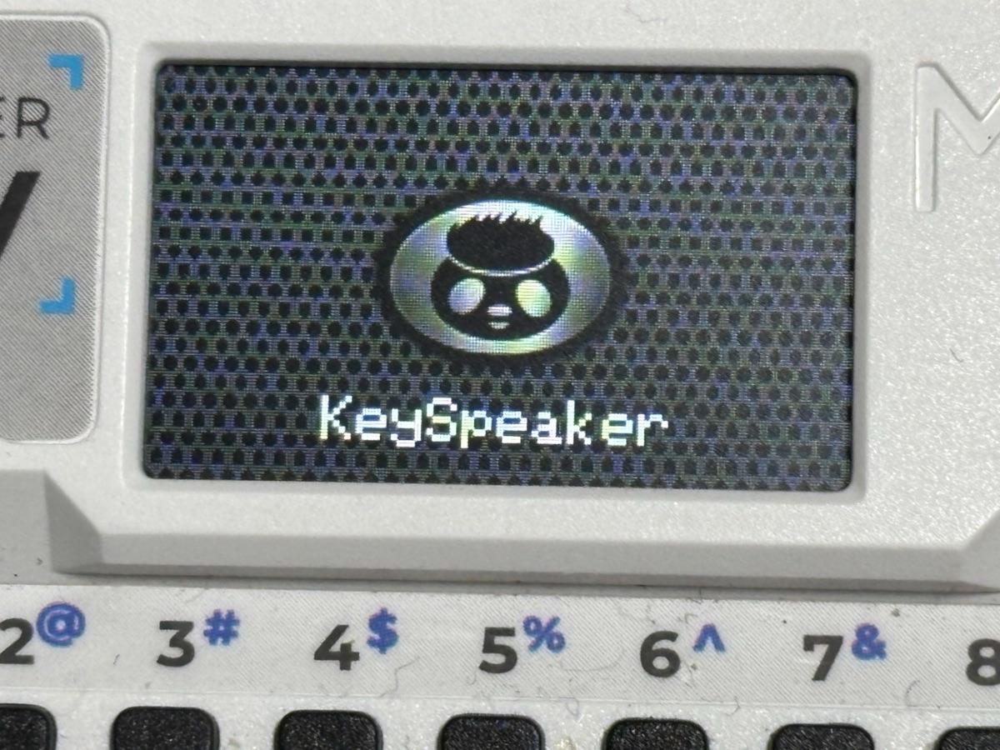

[English README](README.md)

</td>
<td valign="top" width="360">

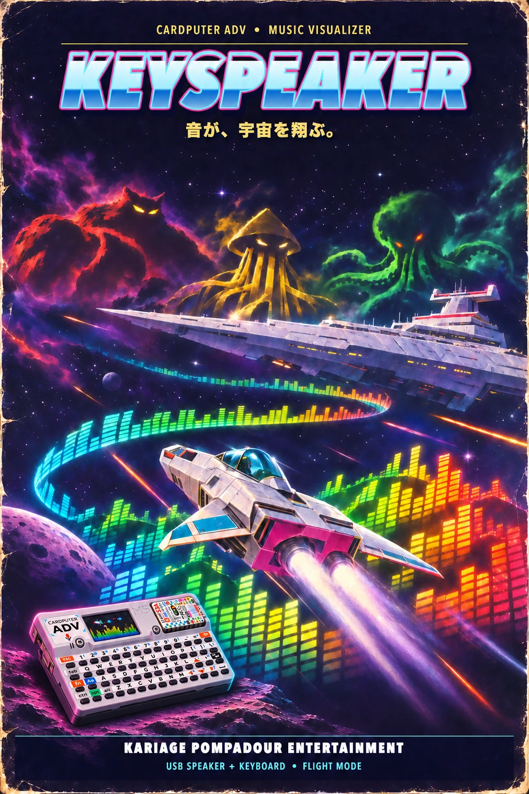

</td>
</tr>
</table>

> **状態: 開発中です。** MacとWindows 11では、USB-Cケーブル1本で、スピーカーとキーボードの両方が使えるようになりました。十分な音量で鳴り（8時間続けて音切れなし、一時停止と再開も問題なし）、
> キーボードで文字が打て、音量や再生のキーも効きます。USBでつないだiPhone 15でも使え、傾きで動かすマウスも使えます。予備として、ケーブルを抜くとBluetooth LEのキーボードとマウスにもなります（MacとWindows 11で確認。USBに戻すには、電源スイッチを切ってリセットボタンを押します）。
> ファームウェアは [`firmware/KeySpeaker_S0/`](firmware/KeySpeaker_S0/)、設計は [`docs/DESIGN_JA.md`](docs/DESIGN_JA.md)、検証記録は [`docs/S0_TEST_JA.md`](docs/S0_TEST_JA.md) にあります。

## 発案のきっかけ

[RADIO DAYS SDR](https://github.com/kariagepompadour/RADIODAYS-SDR)の開発中、Cardputer ADVの内蔵スピーカーが想像より良い音で鳴ることに気づきました。
本格的な音楽鑑賞用ではありませんが、BGM、ニュース、インターネットラジオ、ポッドキャスト、動画の音声を聴くには十分です。
そしてCardputer ADVには物理キーボードがあります。スピーカーとして使いながら、キーボードも入力に使えたら面白いはずです。

## できるようにすること

- **USB-Cケーブルでつなぐと（基本の使い方）**：ケーブル1本で、スピーカーとキーボードになります。
- **ケーブルを抜くと（予備）**：数秒で自動的に、Bluetooth LEのキーボードとマウスになります。
- **相手の機器には何も入れません。** CardputerにKeySpeakerを、LauncherかM5Burnerで入れるだけです（[インストール](#インストール)）。
- **Cardputer ADVとUSB-Cケーブルだけで、全部遊べます。** スピーカー、キーボード、傾きマウス、flight modeは、これだけで動きます。Pico 2のAUXユニット、3Dプリントの箱、ジョグダイヤルは、あとから足せるオプションです（[ハードウェア](#ハードウェア)）。はんだ付けも、3Dプリンターも、要りません。

Bluetooth LE（予備）の制限:

- **USBに戻すとき**：一度抜くと、ケーブルを挿し直してもUSBとして認識されません。ケーブルを挿したまま、電源スイッチを切ってリセットボタンを押してください。キーボード画面に `Off+Reset to USB` と出ます。
- **アプリを切り替えたとき**：[Media Jog](https://github.com/kariagepompadour/Cardputer-ADV-Media-Jog)でペアリングしたパソコンは、KeySpeakerで使うときに一度削除してペアリングし直す必要があります。逆も同じです（Macで確認）。
- つながるのは一度に1台、ペアリングしておけるのは2台までです。

使い方の例:

- スピーカーのないPC（デスクトップPC、Mac mini、モニターなど）につなぐ。
- USB-Cから音声を出せる機器（スマホ、タブレット、デジタルオーディオプレーヤー、ゲーム機）につなぐ。
- ケーブルが届かないところで、予備のBluetooth LEキーボードとマウスとして使う（MacとWindows 11で確認）。
- **USB-Cイヤホンアダプター**として使う：Cardputerのイヤホン端子にイヤホンを挿します（モノラルなので、両耳から同じ音が出ます）。

キーが小さいので、長文ではなく、ちょっとした入力（検索欄、パスワード、ゲーム機の文字入力など）向けです。

## モードとキー

<table>
<tr>
<td valign="top" width="480">

起動すると、スピーカーの網目に付いたかりポムのエンブレムと、「KeySpeaker」の名前が2秒出ます。そのあと `Fn+M` で3つのモードを順に切り替えます（USBのとき）。最後に使ったモードは覚えています。measure mode（計測）では、キー操作も音もない状態が1分続くと、エンブレムに戻り、下に `h HELP  Fn+M KEYBOARD` と出ます。キーを押すまでそのままです（そのキーは画面を戻すだけです）。flight modeは眺めるための画面なので、そのままです。音楽が鳴り出すと、エンブレムがスピーカーのコーンのように、大きな音に合わせて震えます。全部の画面の絵は [`docs/SCREENS_JA.md`](docs/SCREENS_JA.md) にあります。

- **measure mode**（計測）: バッファー、時計のずれ、音量とレベルメーター。キー: スピーカーと再生のキー（下）
- **flight mode**（フライト）: 音楽の上を飛ぶ画面（音量の地形、小さな戦闘機、昭和のグライコ、ときどき戦闘機をつかもうとするモンスター）。キー: スピーカーと再生のキー（下）
- **keyboard mode**（キーボード）: ゆっくり回る地球と、キーの早見表。キー: すべてのキーをPCへ送る

  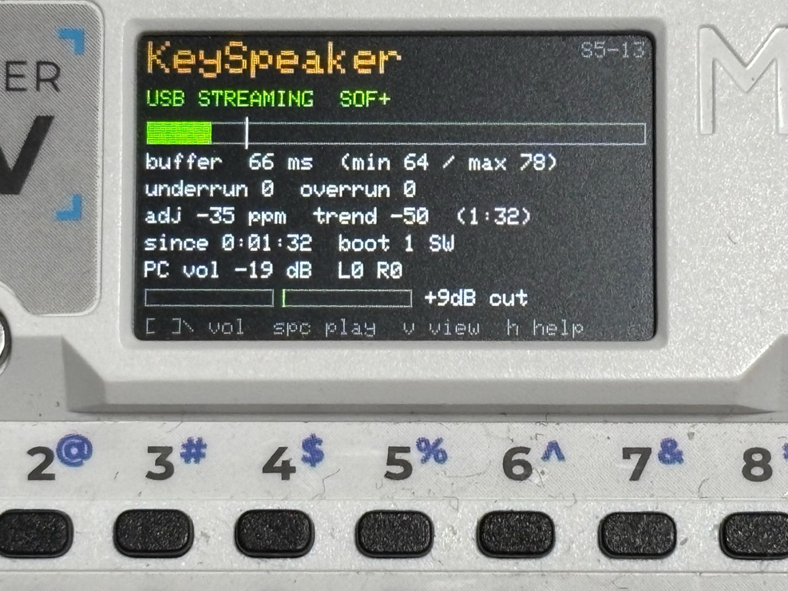
  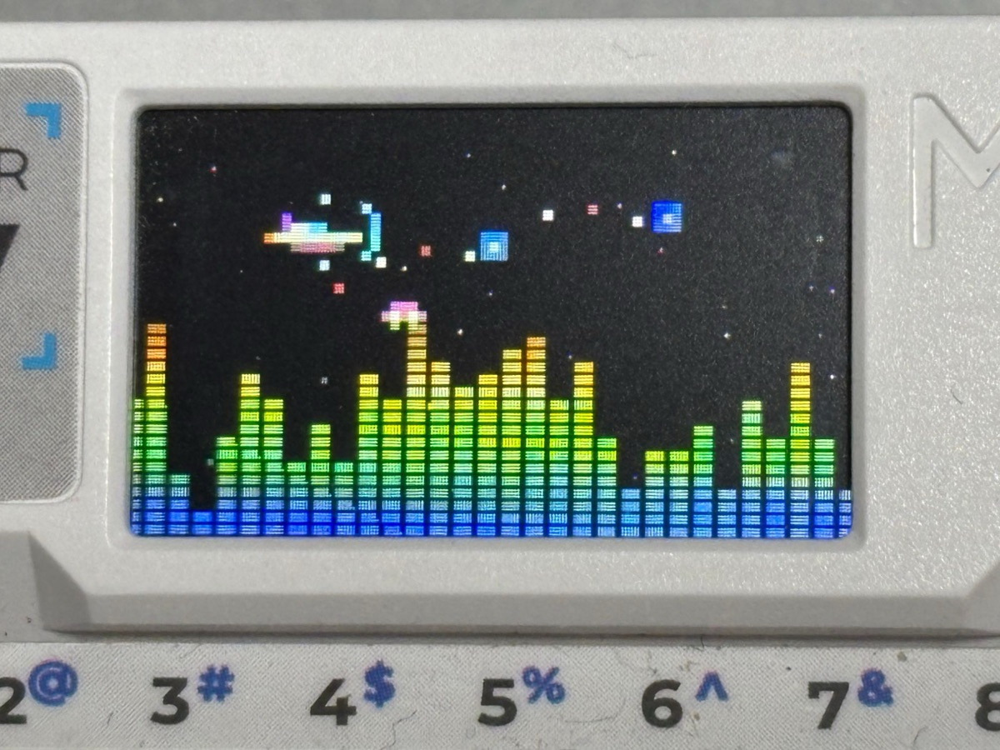
  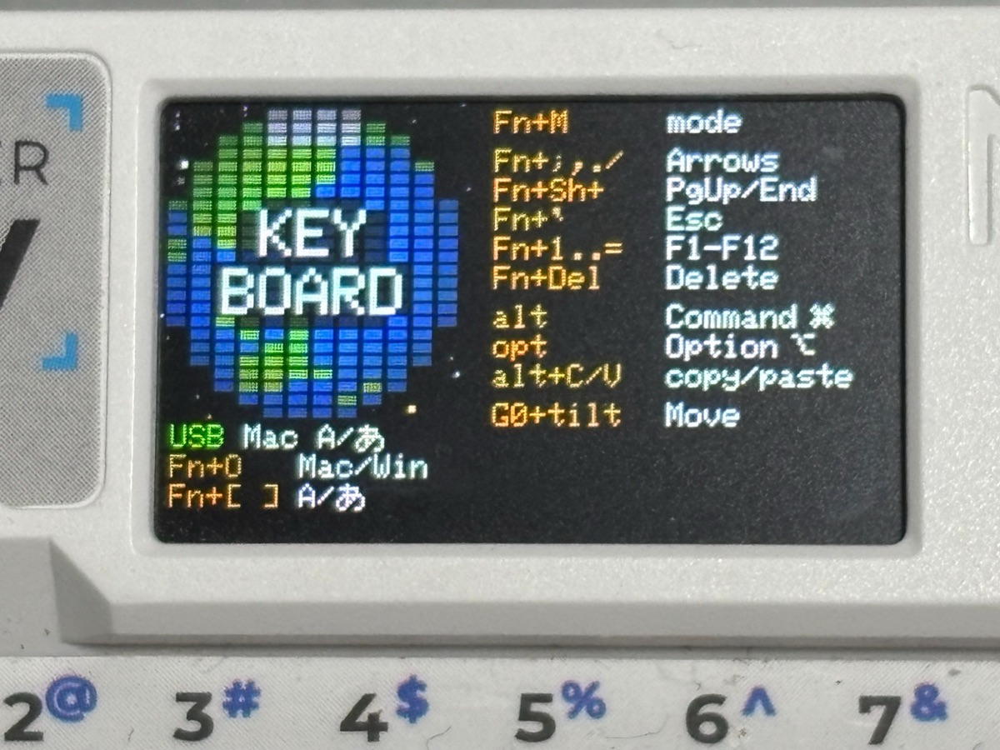

*実機の画面。左から measure mode、flight mode、keyboard mode。*

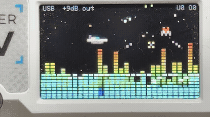

*実機で動くflight mode（3秒）。少し前の版で撮ったので、上に状態の行が出ている。*

**メテオゾーン:** 音楽が流れている間、数分に1回、地形が低くなり、流星が右から左へ流れます。戦闘機は撃つのをやめて、その間をすり抜けます。音が大きいほど、流星が増えます。

</td>
<td valign="top" width="360">

<a href="docs/images/field_guide_ja.webp">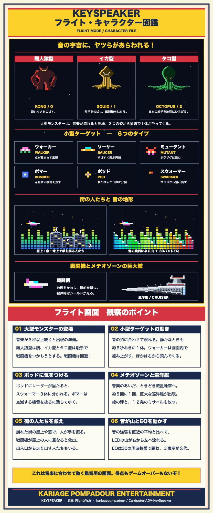</a>

</td>
</tr>
</table>

USBがないとき（Bluetooth LEのとき）は、まずkeyboard modeの画面が出ます。`Fn+M` で、ほかの画面にも動けます。

**マイク入力（`Fn+I`）:** 内蔵マイクで周りの音を聞いて、画面（戦闘機、地形、イコライザー）だけを動かします。音は出さないので、
スピーカーは鳴りません。USBがなくても使えます。`-` / `=` で感度を変えられます（たいていは初期値で足ります）。マイクのあいだは、
keyboard modeの画面の左下に、緑の `MIC` が出ます。そこの緑の `USB` は、ケーブルがつながっていることだけを表します。

**AUX入力（`Fn+I`）:** 別に作る Pico 2 AUXユニットを Grove につなぐと、パソコンのイヤホン端子などの音を、Cardputer のスピーカーで
鳴らせます。ユニットは Cardputer の電気で動き、つないだままにできます。[製作説明書](docs/AUX_PICO2_BUILD_JA.md)と
[設計書](docs/AUX_PICO2_DESIGN_JA.md)を見てください。

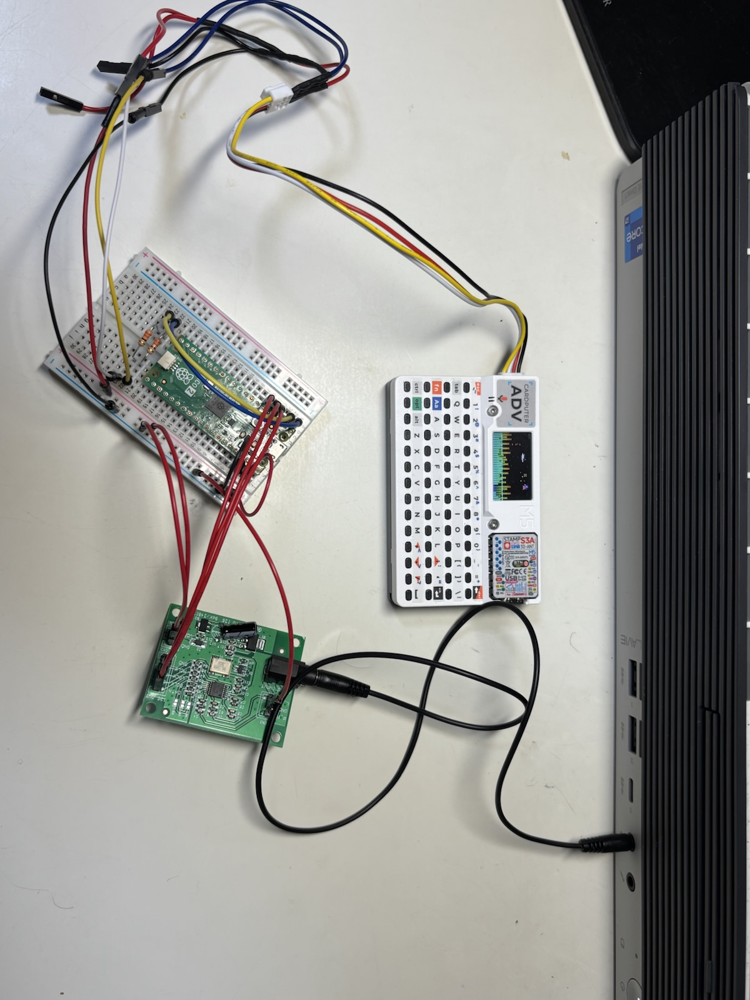

作者の試作機です。Grove ケーブルの途中の余分な線は、前の作品のケーブルを流用したためです。配線は写真ではなく、図と表に従ってください。

同じユニットを 3D プリンターの箱に入れ、蓋に Cardputer ADV をはめたところです([STL](hardware/aux-pico2-box)と[箱のメモ](docs/AUX_PICO2_BOX_JA.md))。右は、AUX のときのデータ画面で、`AUX IN bad 0 lost 0` と出ています。

  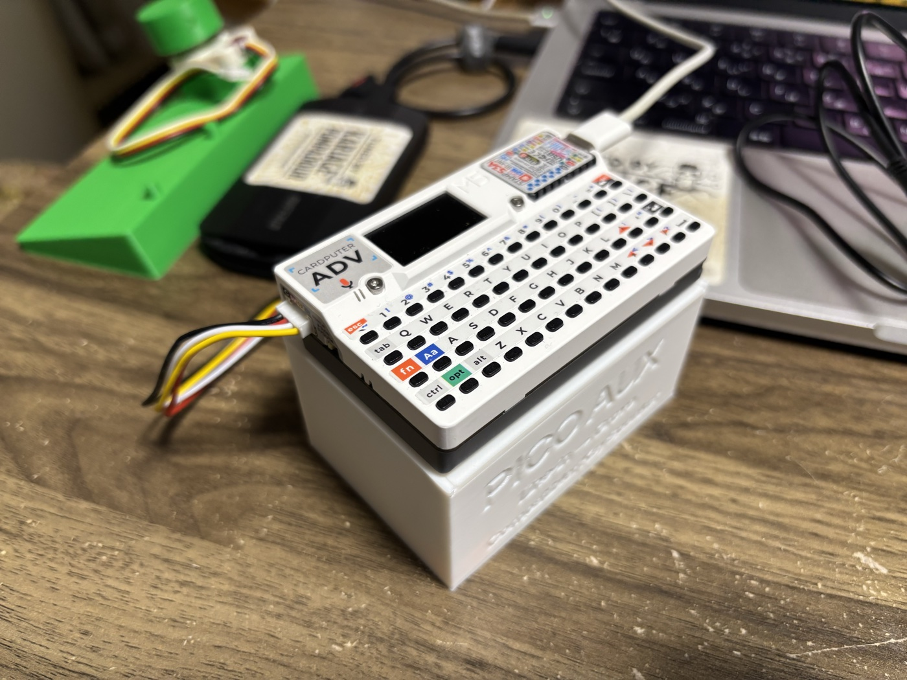
  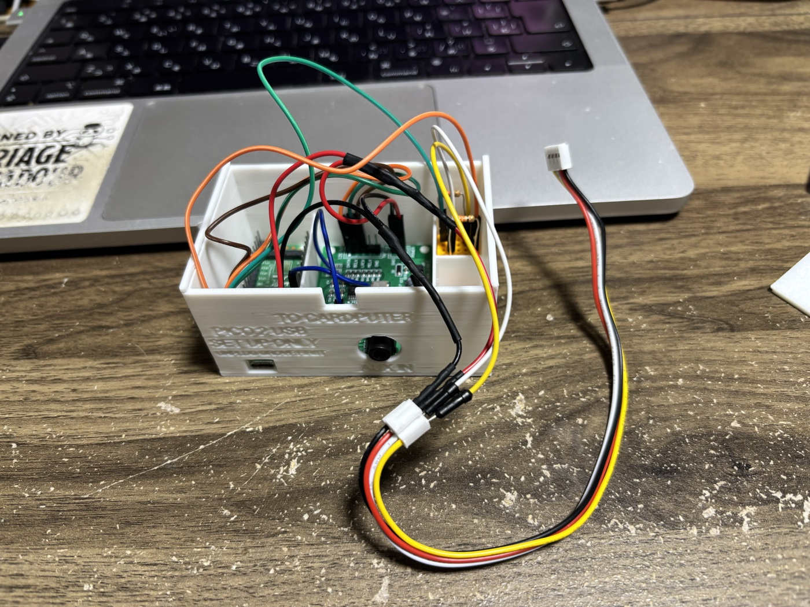
  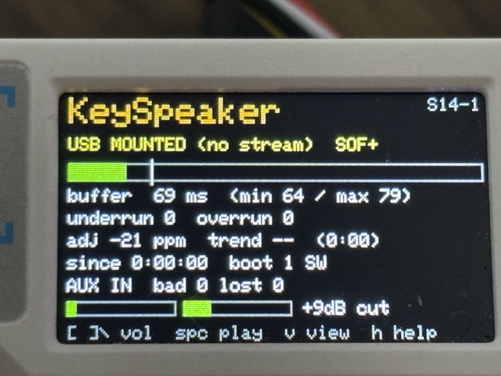

**MP3入力（`Fn+I`）:** microSD カードの `/music` フォルダ（または一番上のフォルダ）に `.mp3` を入れると、4 つ目の入力として
Cardputer が再生します。画面はそのままで、戦闘機やフライトビューが曲に合わせて動きます。パソコンがなくても（バッテリー、モバイルバッテリー、ただの USB
充電器でも）使えます。電源を入れてから 10 秒以内（Bluetooth キーボードが始まる前）に `Fn+I` で MP3 にすると、パソコンなしで次に電源を入れたときも、
MP3 から始まります（USB のときは、いつも USB から始まります）。MP3 のあいだは、Bluetooth キーボードは止まっています。Bluetooth キーボードが
一度始まると、MP3 には電源を入れ直す必要があります（Bluetooth がメモリの大半を使い、返せないためです）。そのとき画面に `RESTART` と出ます。
電池だけで、MP3を10時間とぎれずに再生できました。テストを止めた時点でもまだ鳴っていました（2026-11-14、S16-10、10曲をくり返し、画面オン：underrun 0、overrun 0、再起動なし）。測定画面とフライト画面で、`Space` が一時停止／再生、`,` が前の曲、`/` が次の曲です。
曲はぐるぐる繰り返します。MP3 レイヤー3、32 / 44.1 / 48 kHz、ステレオ／モノラル、320 kbps まで。くわしくは [docs/MP3_DESIGN.md](docs/MP3_DESIGN.md)。
デコーダーは [minimp3](https://github.com/lieff/minimp3)（CC0、パブリックドメイン。[docs/MP3_LICENSE.md](docs/MP3_LICENSE.md) を参照）です。

`Fn+I` を押すたびに、入力が USB、MIC、AUX、MP3 の順に変わります。AUX はユニットがあるときだけ選べます。押すと戦闘機が画面を横切り、
今の入力が大きな文字で出ます。音源がないときは、赤で `NO USB`、`NO AUX`、`NO SD`、`NO MP3`、`RESTART` と出ます。

どのモードでも:

| キー | 動作 |
| --- | --- |
| `Fn+M` | 次のモードへ（USBがなくても効く） |
| `Fn+I` | 入力の切り替え：USBの音、内蔵マイク、AUX、microSD の MP3（上を参照） |
| `Fn+O` | Mac ↔ Windows の切り替え（覚えておく） |

スピーカーと再生のキー（measure mode と flight mode）:

| キー | 動作 |
| --- | --- |
| `[` / `]` / `\` | PCの音量− / 音量＋ / ミュート |
| `Space` | 再生 / 一時停止 |
| `,` / `/` | 前の曲 / 次の曲 |
| `-` / `=` | 持ち上げ量を下げる / 上げる（マイク入力のときは、感度を下げる / 上げる） |
| `b` | 低音カットのオン / オフ |
| `r` | カウンターをリセット |
| `v` | measure mode ↔ flight mode |
| `h` | このキーのヘルプ画面を開く / 閉じる（開いたままでもキーは効きます） |
| そのほかのキー | `h` と同じく、ヘルプ画面を開く / 閉じる |

keyboard mode（文字、Shift、Ctrl、Tab、Enter、Delはそのまま送る）:

| キー | 動作 |
| --- | --- |
| `Fn+;` `Fn+,` `Fn+.` `Fn+/` | ↑ ← ↓ → |
| `Fn+Shift+` 同じキー | PgUp / Home / PgDn / End |
| `` Fn+` `` | Esc |
| `Fn+1` … `Fn+=` | F1 … F12 |
| `Fn+Del` | 前方削除 |
| `Fn+[` / `Fn+]` | 英数 / かな。最後に切り替えたほうを、Macのメニューバーと同じ「A」「あ」で画面に出す |
| `alt` / `opt` | Mac: Command / Option、Windows: Alt / Win |

**傾きで動かすマウス**（keyboard mode）。マウスが手元にないときのためのものです。本体の横のボタン（G0）を押している間、画面にマウスのキーが出て、傾けるとカーソルが動きます。傾きは、G0を押した瞬間の持ち方を基準にします。

| G0を押したまま | 動作 |
| --- | --- |
| 傾ける | カーソルが動く（大きく傾けるほど速く） |
| `A` か `,` | 左クリック（キーを押している間は押したまま。傾ければドラッグ） |
| `D` か `/` | 右クリック |
| `E` か `;` / `Z` か `.` | ↑ / ↓ の矢印キー（メニューの移動、スクロール） |
| `S` | Enter |

**ジョグダイヤル**（なくても使えます）: [Media Jog](https://github.com/kariagepompadour/Cardputer-ADV-Media-Jog)と同じ、M5StackのUnit Encoder（U135）をGroveポートにつなぎます。measure modeとflight modeでは、回すとPCの音量、押すと再生 / 一時停止。keyboard modeでは ← → とEnterを送ります。つなぐのは、Cardputerの電源を切った状態で。

## 対象範囲

| 区分 | 機器 |
| --- | --- |
| **基本の対象** | macOS、WindowsとのUSB接続（スピーカー＋キーボード） |
| **予備** | Bluetooth LEのキーボードとマウス（macOS、Windows） |
| **確認しながら広げる対象** | iPhone 15以降・USB-CのiPad、Android、USB音声出力のあるデジタルオーディオプレーヤー、ゲーム機、ほかの機器でのBluetooth LEキーボード |
| **対象外** | ChromeOS、ワイヤレス音声、インターネットラジオ、3.5mm端子からの音声入力 |

### ワイヤレス音声がない理由

相手の機器にソフトを入れずに、Cardputer ADVをワイヤレススピーカーにすることはできません。

- ESP32-S3にはClassic Bluetoothがないため、Bluetooth音声（A2DP）は使えません。
- Cardputer ADVにはPSRAMがありません。ESP32向けの既知のAirPlay受信実装は、どれもPSRAMを必要とします。
- Wi‑Fiで音声を送るには、相手の機器に送信アプリが必要になります。

### 1つのアプリに1つの仕事

Cardputer ADVには、すでに別の仕事があります。インターネットラジオは[RADIO DAYS](https://github.com/kariagepompadour/RADIODAYS)、
ジョグダイヤルは[Media Jog](https://github.com/kariagepompadour/Cardputer-ADV-Media-Jog)です。それぞれが別のアプリで、Launcherで切り替えます。
KeySpeakerには、設定がいりません。つなげば、スピーカーとキーボードになります。

## インストール

2つの方法があります。

- **Launcherで入れる（ほかのアプリも残せます）**：本体アプリだけの [`firmware/KeySpeaker_S0/KeySpeaker_S0.ino.bin`](firmware/KeySpeaker_S0/) をLauncherから入れます。チェックサムは同じ場所の `SHA256SUMS.txt` にあります。
- **M5Burnerで入れる**：**CARDPUTER** を選び、**KeySpeaker**（kariagepompadourの「Cardputer ADV KeySpeaker」）を検索して書き込みます。本体を丸ごと書き換えるので、Launcherやほかのアプリは消えます。

## 給電

電源につながった機器（PC、Mac mini、ゲーム機）で使うのが一番です。Cardputerも同時に充電されます。
USB-C端子が1つのスマホやタブレットでは、その機器の電池からCardputerに給電されます。給電パススルー（USB PD）対応のUSB-Cハブを使えば、充電しながら使えます。
Cardputerの電源スイッチは**ON**にしてください。

## フォルダー構成

| フォルダー | 内容 |
| --- | --- |
| [`docs/`](docs/) | 設計書と検証記録 |
| [`firmware/`](firmware/) | Cardputer ADVのファームウェア（Arduino、`m5stack:esp32` 3.3.10） |

## ハードウェア

- M5Stack **Cardputer ADV**（ESP32-S3FN8、ES8311コーデック、1Wスピーカー、TCA8418キーボード）。初代Cardputerは対象外です。
- USB-C **データ**ケーブル

必要なのは、これだけです。次のものは、なくても大丈夫なオプションです。

- **AUXユニット**（Pico 2 + PCM1808）：パソコンのイヤホン端子などの音を入れられます（[製作ガイド](docs/AUX_PICO2_BUILD.md)）。
- **3Dプリントの箱**：AUXユニット用です（[STLファイル](hardware/aux-pico2-box)）。AUXユニットを作るときだけ、使います。
- **ジョグダイヤル**（M5Stack Unit Encoder U135）：音量と再生・一時停止を、手で回して操作できます。

## ライセンス

[MIT](LICENSE)
