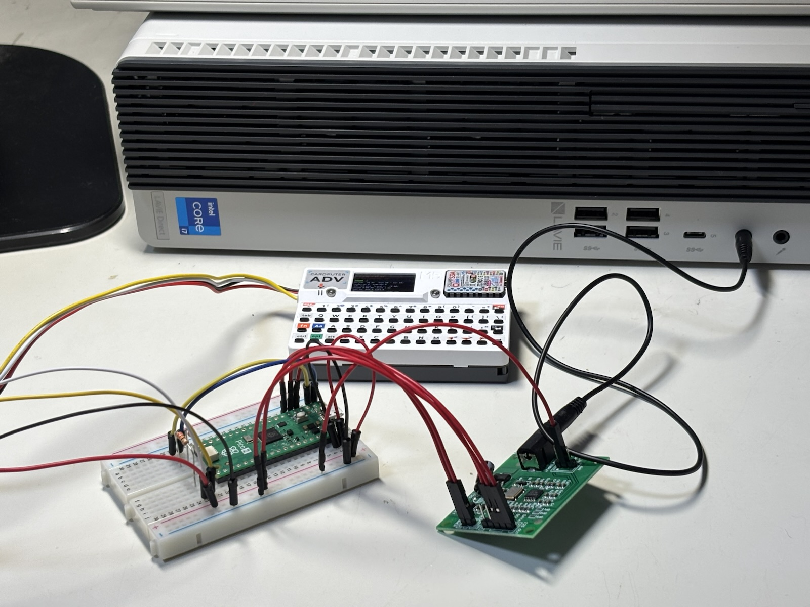
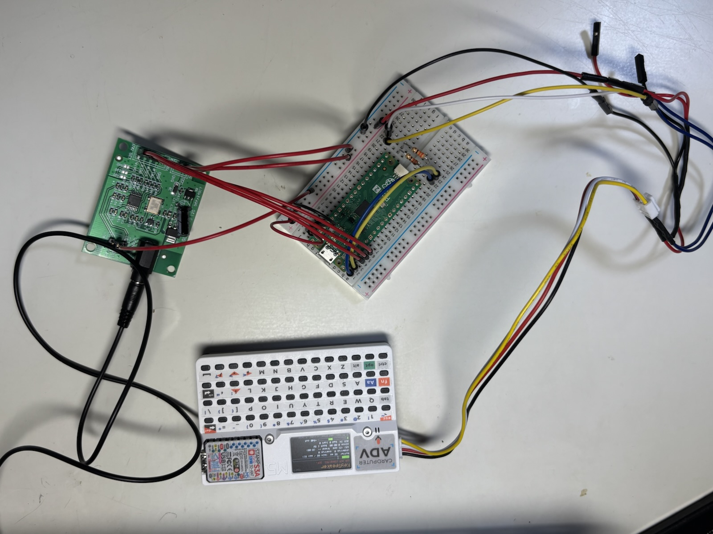
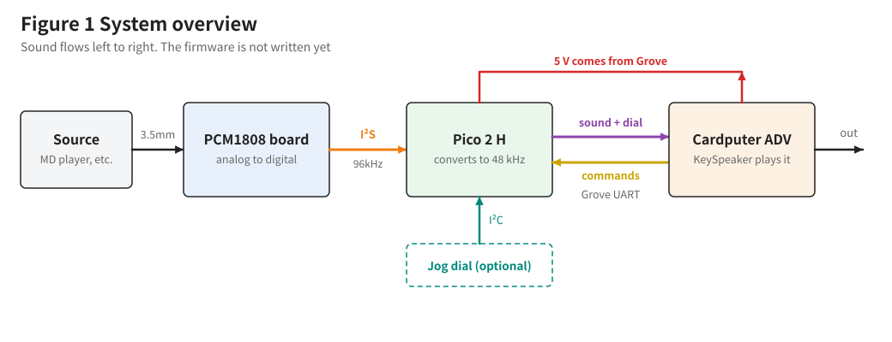
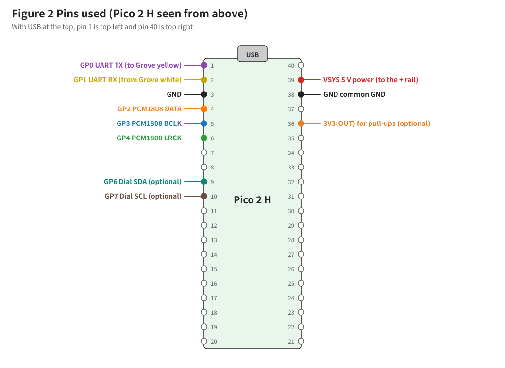
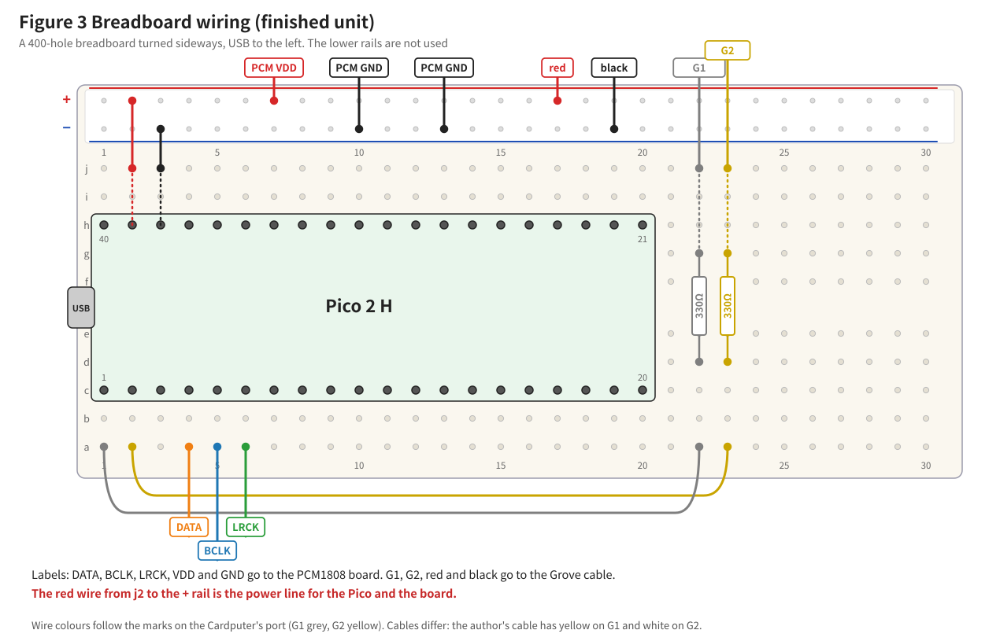
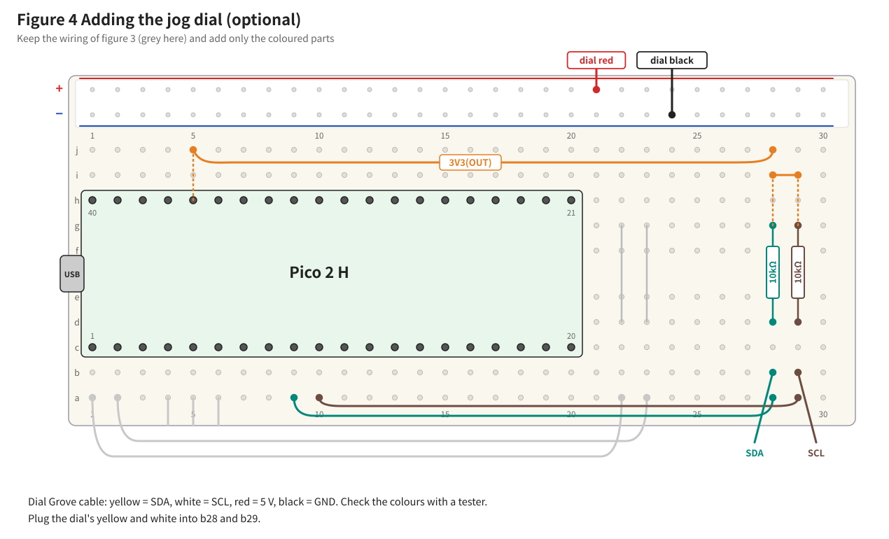
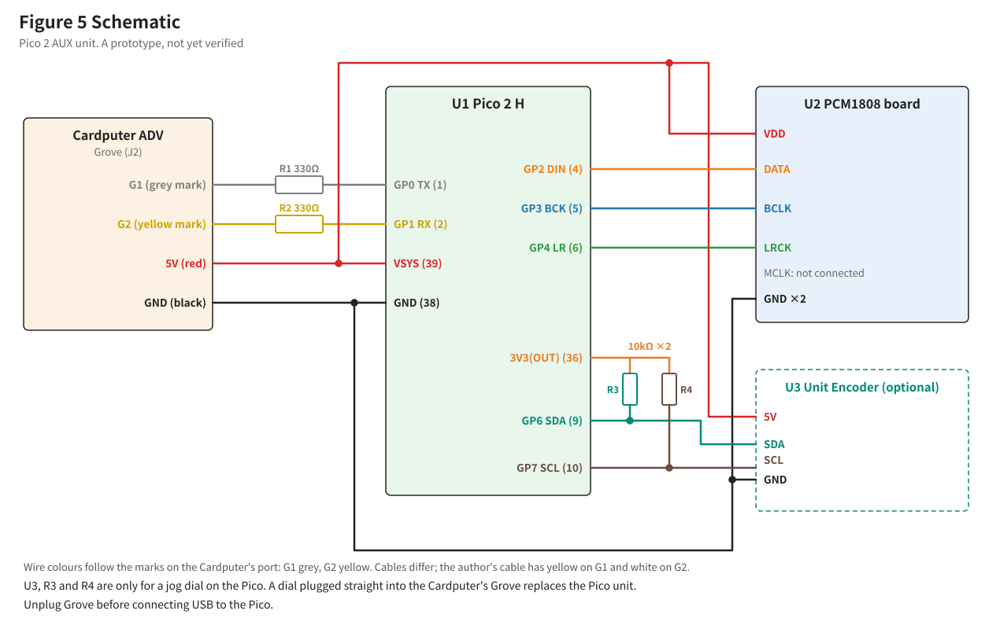

# KeySpeaker Pico 2 AUX Unit: Build Guide

Written 2026-11-07. Status: **sound confirmed on the author's hardware (2026-11-07). The steps for putting the jog dial on the Pico are not yet tried.**

Japanese version: [AUX_PICO2_BUILD_JA.md](AUX_PICO2_BUILD_JA.md). Design: [AUX_PICO2_DESIGN.md](AUX_PICO2_DESIGN.md)

## Before you start

- This unit uses a Raspberry Pi Pico 2 H and a PCM1808 board. The wiring comes from the author's other project, KariPom Ear ( https://github.com/kariagepompadour/KariPom ), where it already works.
- **KeySpeaker is S12-3 and the Pico program is S12-1.** The author confirmed sound with the unit running only on the Cardputer's power.
- No soldering is needed, as long as the Pico 2 H and the PCM1808 board both come with pin headers.
- If you reuse a Pico or a board from another project, step 6 shows whether it still works.

## 1. What the finished unit does

The author's build. The extra wires on the Grove cable are from an earlier project. Follow the figures and tables, not this photo.

- Sound from a computer, a phone or another player comes out of the Cardputer ADV's speaker.
- The unit can stay connected while Launcher starts. There is no switch to flip.
- The jog dial can still go straight on the Cardputer, or on the Pico. On the Pico, it works at the same time as the sound.

## 2. Safety rules

- Always turn the power off before changing any wire. Check the Cardputer's USB cable, its power switch and the Pico's USB cable.
- Unplug the Grove cable before you plug USB into the Pico.
- Connect the red wire (5 V) only to the Pico's VSYS and the PCM1808 board's VDD.
- Do not leave out the two 330 Ω resistors on the Grove wires.

## 3. Parts list

| Part | Qty | Notes |
|---|---|---|
| Raspberry Pi Pico 2 H | 1 | With pin headers |
| PCM1808 board | 1 | Turns sound into numbers. Get one with 3.5 mm line input, I²S output and 5 V DC power |
| Resistor, 330 Ω, 1/4 W | 2 | Stops too much current flowing (Grove wires) |
| Breadboard, 400 holes | 1 | |
| Grove to male jumper cable | 1 | |
| Jumper wires, male to male | about 5 | |
| Jumper wires, male to female | about 6 | For the PCM1808 board |
| 3.5 mm stereo cable | 1 | |
| Multimeter (tester) | 1 | |

**Box version (the author's compact unit).** The author built the same wiring in a 3D-printed box without the 400-hole breadboard and without + and − rails. Differences, all from the author's own unit:

- The two 330 Ω resistors sit on a small 25-hole mini breadboard (Akizuki Denshi 113329, yellow, 20 × 15 mm).
- The Grove red and black wires are each split in two: red to the Pico's VSYS (pin 39) and the PCM1808 board's VDD; black to the Pico's GND (pin 38) and the board's GND.
- The Pico's AGND (pin 33) is joined to the board's CN3 GND (the middle pin, between R_IN and L_IN) with one extra wire.
- The I²S-side GND pin of the board is left empty, and the unit works that way. The author's continuity test (beep mode, all wires removed from the board) shows the board's POWER GND and I²S OUT GND are already joined on the board, which is why it works. The breadboard version in this guide connects it anyway, which does no harm.
- The wires are plugged straight onto the pins, so the hole names such as a22 do not apply.
- Each board sits on four bosses, and a short pin on each boss goes through the board's mounting hole. The author's printed case (CASE5 and its lid TOP5, 2026-11-09) holds both boards without them falling off. The model files are not in this repository yet, so no print instructions are given here.

Go by the marks G1, G2, 5V and GND on the Cardputer's port, not by wire colours, because Grove cables differ. See [AUX_PICO2_BOX.md](AUX_PICO2_BOX.md) for the box and its labels.

If you put the jog dial on the Pico, you also need these:

| Part | Qty |
|---|---|
| Resistor, 10 kΩ, 1/4 W | 2 |
| Grove to male jumper cable | 1 |
| Jumper wires, male to male | 4 |

The PCM1808 board the author bought: https://www.aliexpress.com/item/1005009056060069.html Before you buy, check in the shop's photos that the pin headers are on the board. Without them, you need to solder.

Other PCM1808 boards should also work if they have the same pins (DATA, BCLK, LRCK, VDD and GND), run on 5 V, have a 3.5 mm input, and work as an I²S master at 96 kHz. I²S master means that the board makes the timing of the sound, and the Pico follows it. The author has only tried this one.

Stock and prices are not checked and may change. Ask your shop.

## 4. Pins used

## 5. Assembly

How to read the wiring figure: lay the breadboard sideways with the Pico's USB on the left. A hole is named by its row letter and number, like "a22".

### Step 0: Check the rails

Before you plug anything in, check that each rail runs from end to end. A rail is the line of holes along the red or blue stripe at the edge. On some breadboards, the rails are split in the middle.

⚠️ **On some breadboards, the + rail and the − rail are the other way round from the figure.** Go by the + and − marks printed on your breadboard, not by the position in the figure. If you swap them, 5 V and GND are reversed and parts can be damaged.

1. Set the multimeter to continuity mode (the sound symbol). Touch the tips of the red and black probes together and check that it beeps.
2. **Take two male to male jumper wires, just for this check.** Plug one into the hole at the left end of the − rail and one into the hole at the right end. The probes are too thick to reach the metal inside the holes, so use the wires.
3. Touch a probe to the free end of each wire. **If it beeps, the rail is good.**
4. Check the + rail the same way.
5. If it does not beep, try two holes close together. If close holes beep and far holes do not, the rail is split. Join the two halves with a jumper wire.
6. Pull out the two wires you used for the check.

### Step 1: Plug in the Pico

1. Line up the Pico's pin 1 with c1 and pin 40 with h1.
2. Check that pin 20 goes into c20 and pin 21 into h20.
3. Press it in straight and evenly.

### Step 2: Plug in the two resistors

Plug the 330 Ω resistors across the centre gap. A resistor has no direction.

| Resistor | Holes | Job |
|---|---|---|
| R1 | d22 and g22 | The Pico's transmit line |
| R2 | d23 and g23 | The Pico's receive line |

These two resistors stop too much current flowing. If signals fight through a wiring mistake, parts are less likely to be damaged. They are not there to improve the sound.

The AI designed the circuit with 220 Ω, following the KariPom Ear manual, but the author had 330 Ω on hand and built it with those. A nearby value such as 220 Ω should also work (not tested).

Do not put resistors on the PCM1808 board's signal wires (DATA, BCLK, LRCK).

### Step 3: Plug in the wires on the breadboard

| Wire | From | To | Job |
|---|---|---|---|
| 1 | a1 | a22 | GP0 (transmit) |
| 2 | a2 | a23 | GP1 (receive) |
| 3 | j3 | − rail | GND (pin 38) |
| 4 | j2 | + rail | VSYS (pin 39). Power for the Pico and the board. Use a red wire |

### Step 4: Connect the PCM1808 board

With the power still off, connect these with male to female wires. Leave MCLK empty.

| Board pin | Breadboard |
|---|---|
| DATA | a4 |
| BCLK | a5 |
| LRCK | a6 |
| VDD (POWER) | + rail |
| GND (POWER) | − rail |
| GND (signal side) | − rail |

**Check the PCM1808 board's setting.** On the same side as the chip and the jack, to the side of the I²S OUT header, are small solder pads marked `OP1`, `OP2` and `OP3`. Each one is two small metal squares side by side. Joining them with solder changes how the board works. Look at all three. The back of the board has a printed table that explains them (OP1 open = I²S-24 format; OP2 and OP3 both open = master, 96 kHz).

| What you see | Meaning |
|---|---|
| The two metal squares are apart | Open (this is what you want) |
| A blob of solder joins the two squares | Shorted (the setting has been changed) |

If all three are apart, do nothing and move on. That is the board's factory setting (96 kHz).

A board with OP2 joined by solder is set to 48 kHz. This guide assumes 96 kHz. With the power off, remove the solder from OP2 so that it is open again.

### Step 5: Check everything

- [ ] The Pico's pin 1 is in c1
- [ ] Both resistors are in
- [ ] Nothing is connected to MCLK
- [ ] Only two wires are on the + rail (the holes along the red stripe): the Pico's j2 wire and the PCM1808 board's VDD wire. A signal wire on the 5 V rail can damage the Pico

Last, use the multimeter to check that 5 V and GND are not shorted. If the + rail and − rail are joined, parts can be damaged when you turn the power on.

1. Set the multimeter to continuity mode (the sound symbol). Touch the tips of the red and black probes together and check that it beeps.
2. **Take two male to male jumper wires, just for this check.** Plug one into a free hole on the + rail and one into a free hole on the − rail. Leave the wires from the build where they are.
3. Touch a probe to the free end of each wire: the red probe on the + rail wire, the black probe on the − rail wire.
4. **If it does not beep, all is well.** A short beep that stops at once is fine. That is the board's capacitors charging.
5. If it keeps beeping, do not turn the power on. Look through the wiring again.
6. Pull out the two wires you used for the check.

## 6. Check the Pico and the board (step 6)

Check the Pico and the board on their own before you connect the Cardputer.

### Step 6: Run it on USB

First, count the wires on the rails.

| Rail | Wires | Which |
|---|---|---|
| + rail | 2 | The Pico's VSYS (pin 39, wire from j2), the PCM1808 board's VDD |
| − rail | 3 | The Pico's GND (pin 38, wire from j3), the PCM1808 board's two GND pins |

If the count is wrong, go back to steps 3 and 4 and look through the wiring.

1. Do not connect the Grove cable yet.
2. For this check, the Pico's USB also powers the board. The wiring stays as it is.
3. Hold down the BOOTSEL button on the Pico (the small white button) and plug it into your computer with USB. Let go of the button once it is plugged in.
4. A drive called `RP2350` appears on your computer. Drag the check program `aux_pico2_check.uf2` onto that drive. It is in `firmware/aux_pico2_check/` in this repository.
5. The drive disappears by itself and the Pico restarts. That means the program is written. A message saying the disk was not ejected properly is nothing to worry about.
6. Open a serial monitor such as the one in the Arduino IDE, at speed 115200. Look for `[ OK ] I2S begin`. If it went by before you opened the monitor, that is fine as long as `FFT:` lines are scrolling.
7. Play some sound and check that the numbers on the `FFT:` lines move with it. The `ST>` line comes once a second. If it shows `n=96000 mis=0 ovf=0`, reception is good. `n` is the number of samples received in that second, and `mis` and `ovf` count reception errors.
8. Unplug the USB cable. Leave the wiring as it is.

Writing the program works the same way on Mac and Windows. To read the results, you can also use Tera Term or PuTTY instead of the Arduino IDE.

**Another way to write it:** you can also write the program from the Arduino IDE. See "Appendix: Setting up the Arduino IDE".

If it does not work, see "9. Troubleshooting".

## 7. Check the Grove port (step 7)

### Step 7: Measure the Grove port

Use the multimeter to check that power is reaching the Cardputer's Grove port. You do not need the breadboard or the Pico for this.

1. Set the multimeter's dial to **DC voltage**. The symbol is a `V` with a straight line beside or above it, or `DCV`. If your meter has ranges, pick `20V`. The probe leads plug into holes on the meter: the black lead into the hole marked `COM`, the red lead into the hole marked `V` (it may say `VΩ`). If the leads are fixed to the meter, skip this. If the red lead is in an `A` or `10A` hole, move it.
2. With the Cardputer off, plug the jumper cable into the Grove port. Leave the other end unconnected.
3. Keep the ends of the cable's four wires apart. Taping them to the desk is safest. **If the wire ends touch, you get a short.**
4. Connect the Cardputer to USB, turn it on and wait for KeySpeaker to start.
5. Touch the multimeter's black probe to the metal at the end of the cable's black wire, and keep it there until you finish. Pinch the probe and the wire end together with your fingers so that they press firmly. At 5 V, this is safe. A weak contact makes the numbers wander.
6. Touch the red probe to the metal at the end of the cable's red wire, and write down the number.
7. Measure the white and yellow wires the same way. The black probe stays on the black wire.
8. Unplug the Cardputer's USB cable so that it runs on its battery, and measure the red wire once more. If the power goes off, turn the power switch on.
9. When you finish, turn the Cardputer off and unplug the jumper cable.

| Wire | Expected | Your reading |
|---|---|---|
| Red | about 5 V | On USB ____ V, on battery ____ V |
| White | about 3.3 V | ____ V |
| Yellow | about 3.3 V | ____ V |

- If a colour and its voltage do not match, your cable uses different colours. Work out each wire's job from its voltage and its place in the connector, and read the wiring figure with your colours.
- If red reads about 0 V, first check that the switch beside `PORT.A` is on `5VOUT`. If it still reads about 0 V only on battery, use the Cardputer with USB connected.

This is a good place to stop for a break.

## 8. Connect the Cardputer (steps 8 and 9)

### Step 8: Write the programs and plug in the Grove wires

**Write the Pico program and check that it replaced the old one.** Keep the Grove cable unplugged.

1. Hold down the Pico's BOOTSEL button and plug it into your computer with USB. Let go of the button once it is plugged in.
2. Drag `firmware/AuxPico2/AuxPico2.uf2` onto the `RP2350` drive. The drive disappears by itself and the Pico restarts.
3. Leave the USB cable in and open the serial monitor at speed 115200.
4. Use the table below to check that the new program is running. The steps are the same as in step 6, but the screen looks different once the program has changed.
5. Check that the `ST>` line is close to `n=96000 mis=0 ovf=0`. `link=0 sound=0` is normal while the Cardputer is not connected.
6. Close the serial monitor and unplug the USB cable.

| What to look at | Old program (step 6) | New program |
|---|---|---|
| How the screen scrolls | `FFT:` lines race by | One line a second, slowly |
| What the `ST>` line says | Has `gate=OPEN fft/s=25` | Starts with `ST> S12-1` and has `link=0 sound=0` |

An example line from the new program: `ST> S12-1 n=96000 mis=0 ovf=0 rmsDb=-12.0 link=0 sound=0 sent=0 drop=0 cmd=0 dial=0`

`n=96000 mis=0 ovf=0` appears on the old program's line too, so it cannot tell them apart. Go by the `FFT:` lines being gone and `S12-1` being there.

What to do next for each result:

| On the screen | Meaning | What to do |
|---|---|---|
| The `ST>` line has `S12-1` | The program has changed | Move on |
| `FFT:` lines scroll, no `S12-1` | Still the step 6 program | Start again from 1 |
| `[FAIL] I2S not running` | The program has changed, but it gets no sound from the board | Look through the wiring from step 4 |
| Nothing | Wrong COM port, or the program was not written | Pick the port again. If that does not help, start again from 1 |

**Write KeySpeaker to the Cardputer.** Use KeySpeaker S12-3 or later. The version shows at the top right of the data screen.

**Plug in the Grove wires.**

1. Turn the Cardputer off and unplug its USB cable.
2. Check that the Pico's USB cable is unplugged.
3. Look at the marks beside the Cardputer's Grove port. They say `G`, `5V`, `G2` and `G1`. Plug in the cable and see which colour of wire lines up with which mark.
4. Plug the wires into the breadboard by the marks, not by the colours.

| Cardputer mark | Colour on the author's cable | Breadboard |
|---|---|---|
| `G1` | Yellow | j22 |
| `G2` | White | j23 |
| `5V` | Red | + rail |
| `G` | Black | − rail |

**Watch out: the order of white and yellow differs between cables.** The Cardputer paints `G2` yellow and `G1` grey, but the cable the author bought puts white on `G2` and yellow on `G1`. The colour of a mark and the colour of a wire do not always match. If your colours differ from the figure, your cable is not faulty. Read the letters: the wire on `G1` goes to j22 and the wire on `G2` goes to j23.

**Watch out: there is a `5VIN` / `5VOUT` switch beside `PORT.A`.** Set it to `5VOUT`, because the Cardputer sends power to the unit.

### Step 9: Try it in KeySpeaker

1. Use the 3.5 mm stereo cable to connect your computer's earphone jack to the jack on the PCM1808 board. A phone or a music player works too. If your device has no earphone jack, use an adapter.
2. Turn your computer's volume down.
3. Turn the Cardputer on.
4. Leave the unit connected while Launcher runs.
5. When KeySpeaker has started, wait a few seconds and press `Fn+I`. Each press sends the fighter across the screen and shows the current input in big letters. If no big letters appear, the key press did not count, so press it again. The first press gives `MIC` and the second gives `AUX`. `MIC` makes no sound.
6. Play music or a video on your computer. Turn the volume up slowly and check that sound comes out of the Cardputer's speaker.

| Big letters on the second press | Meaning |
|---|---|
| Green `AUX` | The unit was found and the input is AUX |
| Red `NO AUX` | The unit was not found. See "9. Troubleshooting" |

With a jog dial straight on the Cardputer, you cannot choose AUX, and `NO AUX` does not appear.

If the Cardputer is connected by USB to the same computer, set the computer's sound output to the earphone jack, not to KeySpeaker.

Listen for noise, dropouts, delay and distortion.

## 9. Troubleshooting

| Problem | What to check |
|---|---|
| The computer does not see the Pico on USB | Is the Grove cable unplugged? Is the USB cable a data cable? |
| No `I2S begin`, nothing received | The order of DATA, BCLK and LRCK. 5 V on VDD. OP1 to OP3 are open. GND |
| `FFT:` moves for one side only | The sound source's cable. Is the 3.5 mm plug fully in? |
| Cannot get AUX | Is the `G1` wire on j22 and the `G2` wire on j23? R1 and R2. The Grove red and black wires. Big `NO AUX` means the unit was not found |
| `AUX` shows but there is no sound | Is the computer's sound output the earphone jack? The computer's volume. Is anything plugged into the Cardputer's earphone jack? |
| Sound cuts out | Shorten the wiring. If it still cuts out, lower the link speed (design, section 6) |
| Loud noise | Shorten the wires. Change the source's volume |

## 10. Put the jog dial on the Pico (optional)

**This chapter is future work. The author has not tried it on hardware yet.** You do not need it if the dial goes straight on the Cardputer.

### Step 10: Measure the dial's voltage

Before you connect the dial to the Pico, check its signal voltage.

1. Connect only the dial's red and black wires, to the + rail and the − rail.
2. Turn the Cardputer on and measure the dial's yellow and white wires against black.
3. **If either one is above 3.6 V, do not connect it to the Pico.**
4. Turn the power off.

### Step 11: Add the resistors and wires

Turn the power off before you plug these in.

| Part | Holes |
|---|---|
| 10 kΩ | d28 and g28 |
| 10 kΩ | d29 and g29 |
| Wire | j5 and j28 (3V3) |
| Wire | i28 and i29 (3V3) |
| Wire | a9 and a28 (SDA) |
| Wire | a10 and a29 (SCL) |
| Dial's yellow | b28 |
| Dial's white | b29 |

Start KeySpeaker, then turn and press the dial to check it.

## 11. Use LINE OUT (optional)

**KeySpeaker plays sound on the Cardputer's speaker, so you normally do not need this chapter. You can skip it.**

KariPom Ear could not play sound on the CoreS3, so it was given a LINE OUT for an external speaker. This unit uses the same circuit, so external output is probably possible too. It has not been tried with KeySpeaker.

If your PCM1808 board already has LINE OUT added at CN3, you can use it as it is (chapter 11 of the KariPom design manual shows how to add it). Using the source's earphone jack silences the source's own speaker, but LINE OUT can pass the sound on to an active speaker.

- Plug the source into the PCM1808 board's existing jack as usual. Do not plug it into CN3.
- Keep the 470 Ω resistors at CN3.
- LINE OUT splits off at the board's sound input, so the Pico and Cardputer wiring does not change.
- If an active speaker and the Cardputer play together, the Cardputer may sound slightly late.

## Appendix: Setting up the Arduino IDE

You do not need this if you drag `.uf2` files. Do it only if you want to write programs from the Arduino IDE.

1. Open the preferences. In Arduino IDE 1.8, use **File → Preferences**. In version 2, use **File → Preferences** too (on a Mac, it is in the Arduino IDE menu).
2. In "Additional Boards Manager URLs", enter the line below and press OK. If there is already another URL, add this on a new line.

`https://github.com/earlephilhower/arduino-pico/releases/download/global/package_rp2040_index.json`

3. Open **Tools → Board → Boards Manager** and search for `pico`. Install **Raspberry Pi Pico/RP2040/RP2350** by Earle F. Philhower, III. If it does not appear, restart the IDE.
4. Choose **Raspberry Pi Pico 2** in **Tools → Board**.
5. In **Tools → Manage Libraries**, install `arduinoFFT` by kosme.
6. Open this sketch and upload it.

`https://github.com/kariagepompadour/KariPom/blob/master/pico2-pcm1808/karipom_pico2/karipom_pico2.ino`

⚠️ **Arduino Mbed OS RP2040 Boards**, which has a very similar name, does not work with the Pico 2. It is the only one listed until you add the URL above.

💡 The URLs are long, so copy and paste them. On another computer, search the web for `arduino-pico github`, and the official page has the same URL.

💡 If you get stuck, show a photo of the screen or the error text, along with this guide, to an AI such as Claude and ask. That often solves it.

## Appendix: Schematic

