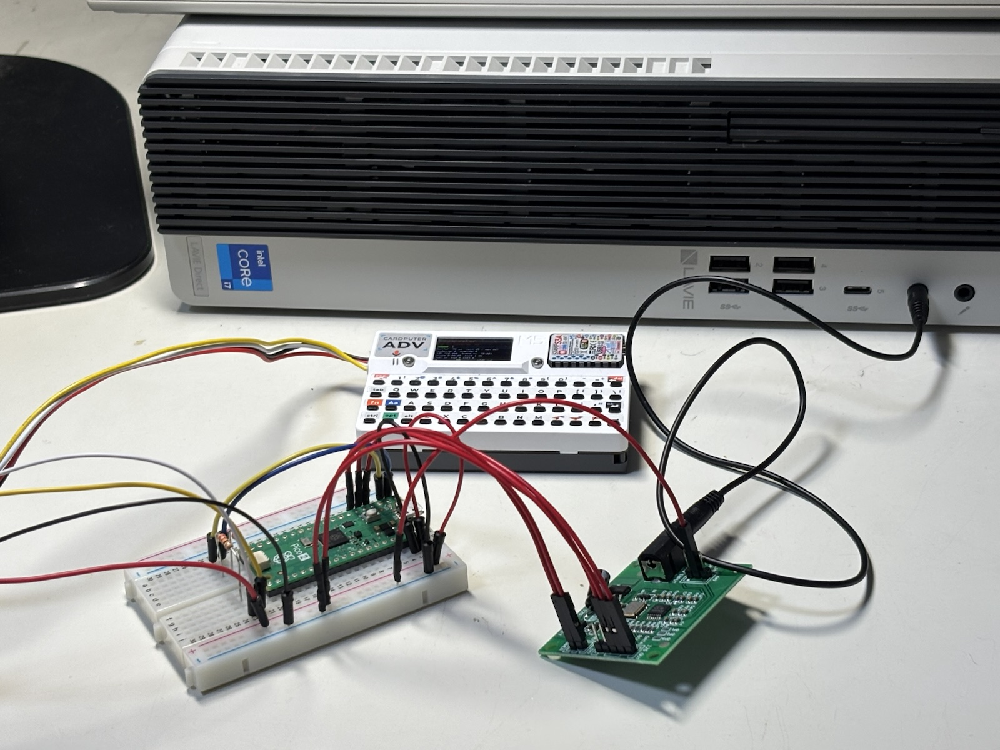
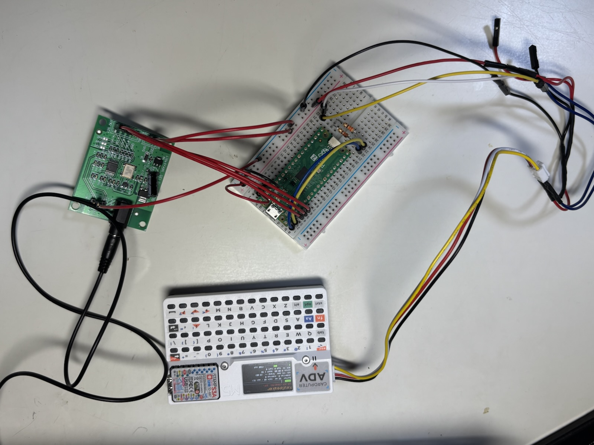
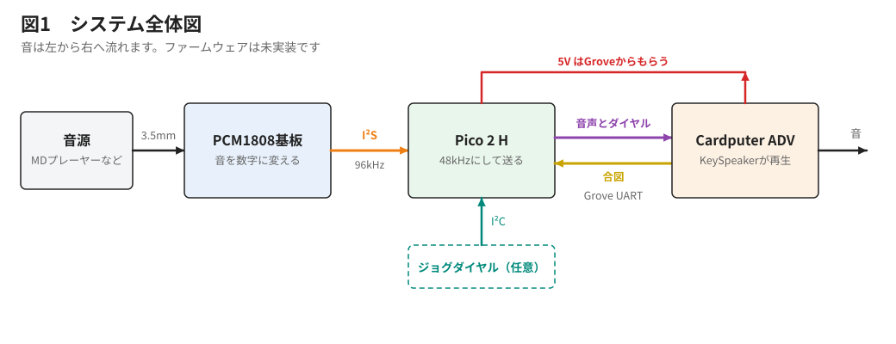
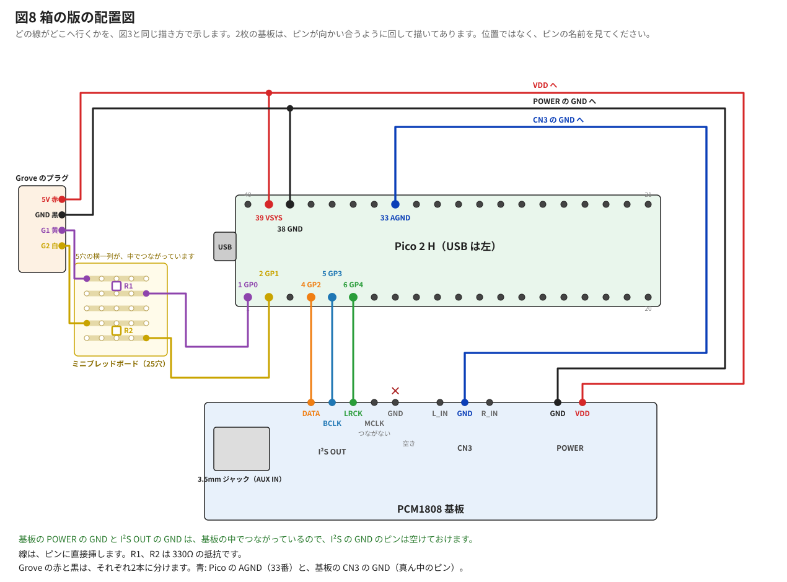
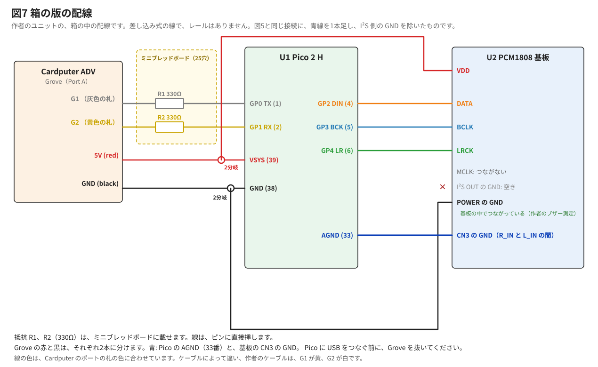
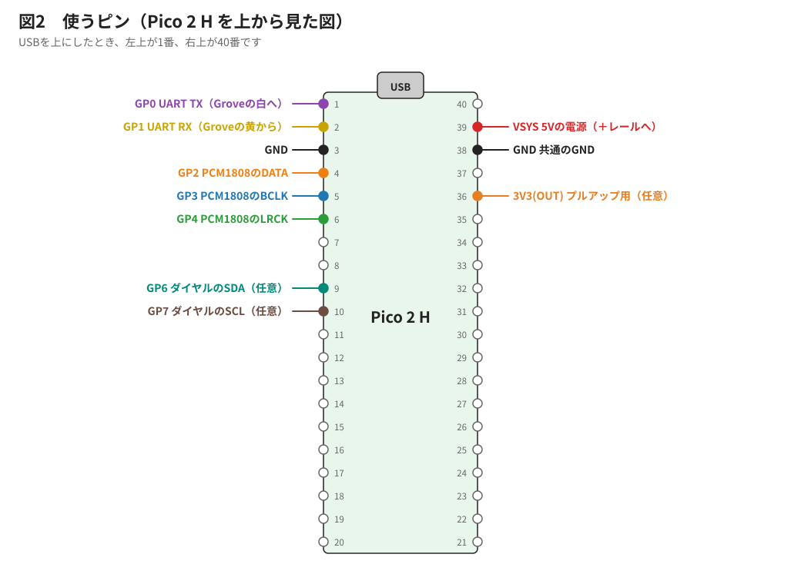
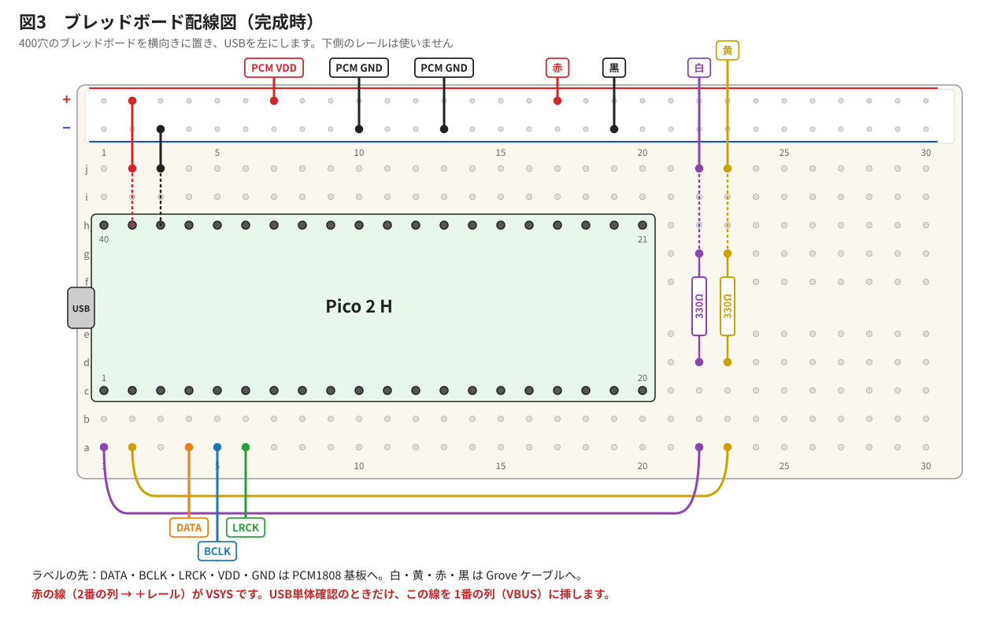
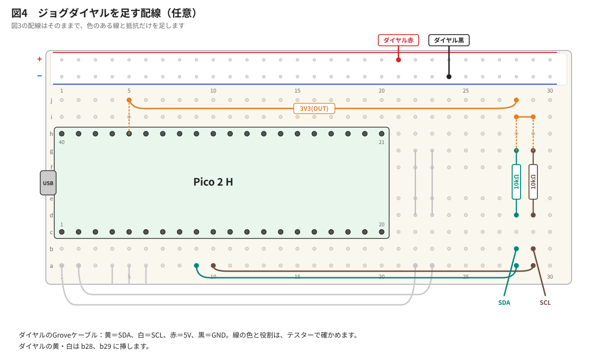
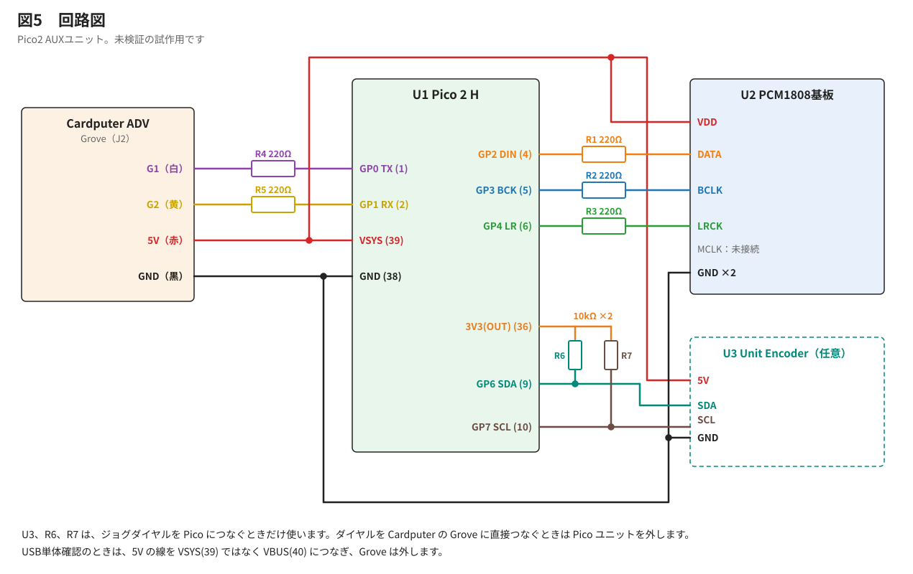

# KeySpeaker Pico2 AUXユニット 製作説明書

作成日：2026-11-07　状態：**作者の実機で音が鳴ることを確かめました（2026-11-07）。ジョグダイヤルを Pico につなぐ手順は、まだ確かめていません。**

英語版：[AUX_PICO2_BUILD.md](AUX_PICO2_BUILD.md)　設計書：[AUX_PICO2_DESIGN_JA.md](AUX_PICO2_DESIGN_JA.md)

## はじめに確認すること

- Raspberry Pi Pico 2 H と PCM1808 基板を使います。この組み合わせは、作者の別の作品「かりぽむ Ear」（ https://github.com/kariagepompadour/KariPom ）で動作している配線が元になっています。
- **KeySpeaker は S12-3、Pico のプログラムは S12-1 です。** 作者の実機で、Cardputer の電気だけで動かして、音が鳴ることを確かめました。
- 半田付けはいりません（ピンヘッダー付きの Pico 2 H と、ヘッダー付きの PCM1808 基板の場合）。
- このリポジトリの名前（`AUX_PICO2` など）の「Pico 2」は、Raspberry Pi Pico 2 の仲間のことです。作者のユニットは **Pico 2 H** を使っています。Pico 2 H は、ピンヘッダーを最初から付けた Pico 2 のことです（Raspberry Pi の呼び方で、作者は確かめていません）。
- ヘッダーなしの Pico 2 でも、ピンヘッダー（20 ピンの列を 2 本）を自分で半田付けすれば使えます。半田ごてと、少しの慣れが必要です。作者は Pico 2 H でしか作っていません。初めての人は、H 付きを買ってください。
- 別の作品で使っていた Pico や基板を流用するときは、手順6で壊れていないことを確かめます。

## 1. 完成すると何ができるか

作者の試作機です。Grove ケーブルの途中の余分な線は、前の作品のケーブルを流用したためです。配線は写真ではなく、図と表に従ってください。

- パソコンやスマートフォンなどの音を、Cardputer ADV のスピーカーで鳴らせます。
- つないだまま Launcher を起動できます。スイッチの操作はいりません。
- ジョグダイヤルは、今までどおり Cardputer につなぐことも、Pico につなぐこともできます。Pico につなげば、音と同時に使えます。

## 2. 安全のお約束

- 配線を変えるときは、必ず電源を切ります。Cardputer の USB と電源スイッチ、Pico の USB を確認します。
- Pico に USB をつなぐときは、Grove を外します。
- 赤い線（5V）を、Pico の VSYS と PCM1808 基板の VDD 以外につながないでください。
- Grove の線に入れる 330Ω の抵抗2本は、省略しないでください。

## 3. 部品表

| 部品 | 数 | 備考 |
|---|---|---|
| Raspberry Pi Pico 2 H | 1 | ピンヘッダーを最初から付けたもの。ヘッダーなしの Pico 2 でも、自分でヘッダーを半田付けすれば使えます（上を参照） |
| PCM1808 基板 | 1 | 音を数字に変える基板。3.5mm ライン入力、I²S 出力、DC5V 駆動のもの |
| 抵抗 330Ω 1/4W | 2 | 電流が流れすぎるのを防ぐ（Grove の線） |
| ブレッドボード 400穴 | 1 | |
| Grove とジャンパー線（オス）の変換ケーブル | 1 | |
| ジャンパー線 オス–オス | 約5本 | |
| ジャンパー線 オス–メス | 約6本 | PCM1808 基板用 |
| 3.5mm ステレオケーブル | 1 | |
| テスター | 1 | |

**箱入り版（作者のコンパクトなユニット）。** 作者は、同じ配線を、400穴のブレッドボードと＋・−レールを使わずに、3Dプリンターの箱の中に作りました。違いは次のとおりで、すべて作者のユニットでのことです。

- 330Ω の抵抗2本は、小さな25穴のミニブレッドボード（秋月電子 113329、黄色、20 × 15 mm）に載せています。
- Grove の赤と黒は、それぞれ2本に分けています。赤は Pico の VSYS（39番ピン）と PCM1808 基板の VDD へ、黒は Pico の GND（38番ピン）と基板の GND へ。分岐は半田付けして、つなぎ目に熱収縮チューブをかぶせています（下の「Grove の赤と黒を 2 分岐する」を見てください）。
- Pico の AGND（33番ピン）と、基板の CN3 の GND（R_IN と L_IN の間の真ん中のピン）を、1本の線でつないでいます。
- 基板の I²S 側の GND のピンは空けてあり、その形で動いています。作者が（基板の線をすべて外して）テスターのブザーモードで測ると、基板の POWER の GND と I²S OUT の GND は、基板の中ですでにつながっていました。動く理由はそれです。この説明書のブレッドボード版は、念のためここもつなぎます。害はありません。
- 線は、ピンに直接挿しています。a22 のような穴の名前は、当てはまりません。
- 基板は4つの台座に載り、各台座の短いピンが基板の取り付け穴に通ります。作者が印刷した箱(`pico-aux-case.stl` と `pico-aux-lid.stl`。作者の 2026-11-09 の CASE5 と TOP5)は、2枚の基板を、落ちることなく保持します。モデルのファイルは [hardware/aux-pico2-box](../hardware/aux-pico2-box) にあります(`pico-aux-case.stl` と `pico-aux-lid.stl`)。印刷の手順は、まだ書いていません。

Grove のケーブルは色が違うことがあるので、線の色ではなく、Cardputer のポートの G1、G2、5V、GND の表示を見てください。箱とその文字は [AUX_PICO2_BOX_JA.md](AUX_PICO2_BOX_JA.md) を見てください。

箱の版を、図3と同じ描き方にしたものです。先に線の配置図、次に、同じ配線を回路図にしたものです。

**Grove の赤と黒を 2 分岐する。** 箱の版では、Grove の赤い線と黒い線が、それぞれ 2 か所につながるので、1 本ずつ 2 つに分けます。半田ごて、はんだ、ワイヤーストリッパー、熱収縮チューブ（太さ 2〜3 mm くらい）が要ります。熱収縮チューブは、熱を加えると縮んで、つなぎ目を包む、プラスチックのチューブです。作者の写真には、つなぎ目に熱収縮チューブがかぶせてあるのが写っています。ただ、チューブの太さや、正確なやり方は記録していないので、次の手順は、一般的な助言です。

1. Grove の線 1 本につき、ジャンパー線を 2 本用意します（片方の端がソケットで、ピンに挿せるもの）。もう片方の端を切り落として、3〜4 mm、被覆をむきます。
2. 半田付けする**前に**、長さ 2 cm くらいの熱収縮チューブを、Grove の線に通しておきます。あとからは、通せません。
3. Grove の線の被覆を、3〜4 mm むきます。ジャンパー線 2 本の端といっしょによじって、3 本をまとめて半田付けします。
4. チューブをつなぎ目までずらして、熱を加えます（ヒートガン、ドライヤー、少し離して動かしながら当てるライターなど）。ぴったり縮んだらできあがりです。Grove のプラグには、熱を当てないでください。
5. 赤と黒は、1 本ずつ作ります。チューブも、それぞれに使って、2 つのつなぎ目が、互いに触れないようにします。
6. 電源を切った状態で、テスターのブザーのモードで、同じ線の 2 本のソケットの間は鳴り、赤と黒の間は**鳴らない**ことを確かめます。

ジョグダイヤルを Pico につなぐときは、次も用意します。

| 部品 | 数 |
|---|---|
| 抵抗 10kΩ 1/4W | 2 |
| Grove とジャンパー線（オス）の変換ケーブル | 1 |
| ジャンパー線 オス–オス | 4本 |

作者が買った PCM1808 基板： https://www.aliexpress.com/item/1005009056060069.html 　買う前に、お店の写真で、基板にピンヘッダーが付いていることを確かめてください。付いていないと、半田付けが必要です。

ほかの PCM1808 基板でも、同じ端子（DATA、BCLK、LRCK、VDD、GND）があり、5V で動き、3.5mm 入力があり、96kHz の I²S マスターとして動くものなら、使えるはずです。I²S マスターとは、基板が音のタイミングを作り、Pico がそれに合わせる動作のことです。作者が確かめたのは、この基板だけです。

在庫と価格は未確認で、変わることがあります。お店で確かめてください。

## 4. 使うピン

## 5. 組み立て

配線図の見方：ブレッドボードを横向きに置き、Pico の USB を左にします。穴の場所は「a22」のように、列の文字と番号で書きます。

### 手順0　レールを確かめる

部品を挿す前に、レール（端にある赤い線と青い線に沿った穴の列）が端から端までつながっているかを確かめます。ブレッドボードによっては、レールが途中で分かれています。

⚠️ **＋レールと−レールの並びは、ブレッドボードによって図と逆のことがあります。** 図の位置ではなく、手元のブレッドボードに印刷された＋と−の印に合わせて挿してください。逆に挿すと、5VとGNDを取り違えて部品を壊すおそれがあります。

1. テスターを導通モード（音のマーク）にします。赤と黒の棒の先を触れさせて、音が鳴ることを確かめます。
2. **確認のためだけに、オス–オスのジャンパー線を2本用意します。** −レールの左端と右端の穴に、1本ずつ挿します。テスターの棒は太くて穴の金具に届かないので、線を使います。
3. 2本の線の、挿していない側の先端に棒を当てます。**鳴れば OK です。**
4. ＋レールも同じように確かめます。
5. 鳴らないときは、近い穴どうしで試します。近い穴で鳴り、離れた穴で鳴らないときは、レールが途中で分かれています。分かれ目の両側をジャンパー線でつなぎます。
6. 確認に使った2本の線を抜きます。

### 手順1　Pico を挿す

1. Pico の1番ピンを c1、40番ピンを h1 に合わせます。
2. 20番ピンが c20、21番ピンが h20 に入ることを確かめます。
3. まっすぐ、均等に押し込みます。

### 手順2　抵抗を2本挿す

330Ω の抵抗を、中央の溝をまたいで挿します。抵抗に向きはありません。

| 抵抗 | 穴 | 役目 |
|---|---|---|
| R1 | d22 と g22 | Pico の送信 |
| R2 | d23 と g23 | Pico の受信 |

この2本は、電流が流れすぎるのを防ぐための抵抗です。配線ミスなどで信号がぶつかったときに、部品が壊れにくくなります。音を良くするための部品ではありません。

AIは「かりぽむ Ear」のマニュアルを参考に220Ωで回路を設計しましたが、作者の手持ちが330Ωだったので、330Ωで作りました。220Ωなど近い値でも動く見込みです（未確認）。

PCM1808 基板の信号線（DATA、BCLK、LRCK）には、抵抗を入れません。

### 手順3　ブレッドボードの中の線を挿す

| 線 | から | まで | 役目 |
|---|---|---|---|
| 1 | a1 | a22 | GP0（送信） |
| 2 | a2 | a23 | GP1（受信） |
| 3 | j3 | −レール | GND（38番） |
| 4 | j2 | ＋レール | VSYS（39番）。Pico と基板の電源の線です。赤い線を使います |

### 手順4　PCM1808 基板をつなぐ

電源を切ったまま、オス–メスの線でつなぎます。MCLK には何も挿しません。

| 基板の端子 | ブレッドボード |
|---|---|
| DATA | a4 |
| BCLK | a5 |
| LRCK | a6 |
| VDD（POWER） | ＋レール |
| GND（POWER） | −レール |
| GND（信号側） | −レール |

**PCM1808 基板の設定を確かめます。** チップやジャックと同じ面の、I²S OUT 端子の脇に、`OP1`、`OP2`、`OP3` と書かれた小さな半田パッド（金属の四角が2つ並んだ場所）があります。ここを半田でつなぐかどうかで、基板の動作が変わります。3か所を見てください。基板の裏には、その説明の表が印刷されています（OP1 が開放なら I²S-24 形式。OP2 と OP3 がともに開放ならマスター、96kHz）。

| 見た目 | 意味 |
|---|---|
| 2つの金属が離れている | 開放（これでOK） |
| 2つの金属が半田の山でつながっている | ショート（設定が変わっている） |

3か所とも離れていれば、何もせず次へ進みます。これが基板の出荷時の設定（96kHz）です。

OP2 が半田でつながっている基板は、48kHz の設定です。この説明書は 96kHz を前提にしています。電源を切った状態で OP2 の半田を取り除き、開放に戻してください。

### 手順5　全体の見直し

- [ ] Pico の1番ピンが c1 にある
- [ ] 抵抗が2本ある
- [ ] MCLK に線がない
- [ ] ＋レール（赤い線に沿った穴の列）に挿さっているのは、Pico の j2 の線と PCM1808 基板の VDD の線の2本だけ。信号線が5Vの列に挿さっていると、Pico が壊れるおそれがあります

最後に、テスターで5VとGNDのショートがないことを確かめます。＋レールと−レールが直接つながっていると、電源を入れたときに部品を壊すおそれがあります。

1. テスターを導通モード（音のマーク）にします。赤と黒の棒の先を触れさせて、音が鳴ることを確かめます。
2. **確認のためだけに、オス–オスのジャンパー線を2本用意します。** ＋レールと−レールの空いている穴に、1本ずつ挿します。組み立てに使った線は、そのままにします。
3. 2本の線の、挿していない側の先端に棒を当てます。赤い棒は＋レールの線、黒い棒は−レールの線です。
4. **鳴らなければ OK です。** 当てた瞬間だけ短く鳴って止まるのは、基板のコンデンサのためなので問題ありません。
5. 鳴り続けたら、電源を入れず、配線を見直します。
6. 確認に使った2本の線を抜きます。

## 6. Pico と基板の確認（手順6）

Cardputer につなぐ前に、Pico と基板だけで確かめます。

### 手順6　USB で動かす

始める前に、レールに挿さっている線の本数を確かめます。

| レール | 本数 | 線 |
|---|---|---|
| ＋レール | 2本 | Pico の VSYS（39番ピン、j2 の線）、PCM1808 基板の VDD |
| −レール | 3本 | Pico の GND（38番ピン、j3 の線）、PCM1808 基板の GND 2か所 |

本数が違うときは、手順3と手順4に戻って配線を見直します。

1. Grove のケーブルは、まだつなぎません。
2. この確認では、Pico の USB から基板にも電源が届きます。配線はそのままです。
3. Pico の BOOTSEL ボタン（基板の白い小さなボタン）を押したまま、USB でパソコンにつなぎます。つないだらボタンを離します。
4. パソコンに `RP2350` という名前のドライブが出ます。確認用ファイル `aux_pico2_check.uf2` を、そのドライブへドラッグします。リポジトリの `firmware/aux_pico2_check/` にあります。
5. ドライブが自動で消えて、Pico が再起動します。これで書き込みは完了です。「ディスクが正しく取り出されませんでした」と出ても、問題ありません。
6. Arduino IDE などのシリアルモニターを、速度 115200 で開きます。`[ OK ] I2S begin` が出ることを確かめます。モニターを開く前に流れて見えなくても、次の `FFT:` の行が流れていれば問題ありません。
7. 音を流し、`FFT:` の行の数字が音に合わせて動くことを確かめます。1秒ごとに出る `ST>` の行で、`n=96000 mis=0 ovf=0` となっていれば、受信は正常です。`n` は1秒間に受け取った音の数、`mis` と `ovf` は受信の乱れの数です。
8. USB を抜きます。配線はそのままにします。

書き込みは Mac でも Windows でも同じ方法でできます。結果を見るためのシリアルモニターは、Arduino IDE のほか、Tera Term や PuTTY でもかまいません。

**別の書き込み方：** Arduino IDE から書き込むこともできます。「付録　Arduino IDE の準備」を見てください。

動かないときは、「9. うまくいかないとき」を見てください。

## 7. Grove の確認（手順7）

### 手順7　テスターで Grove を確かめる

Cardputer の Grove 端子に電気が来ているか、テスターで測ります。ブレッドボードと Pico は使いません。

1. テスターのつまみを**直流電圧**に合わせます。記号は `V` の横か上に直線があるものか、`DCV` です。範囲を選ぶテスターなら `20V` にします。テスターの棒の線の根元は、テスター本体の穴に挿します。黒い線は `COM`、赤い線は `V`（`VΩ` などの表示もあります）と書かれた穴です。線が本体に固定されているテスターなら、この作業はいりません。赤い線が `A` や `10A` の穴に挿さっていたら、挿し替えます。
2. Cardputer の電源を切った状態で、変換ケーブルを Grove 端子に挿します。ケーブルの先はどこにもつなぎません。
3. ケーブルの4本の線の先を、互いに触れないように離します。テープで机に留めると安全です。**線の先どうしが触れると、ショートします。**
4. Cardputer に USB をつないで電源を入れ、KeySpeaker が起動するまで待ちます。
5. テスターの黒い棒を、ケーブルの黒い線の先の金属に当てます。測り終わるまで、当てたままにします。棒と線の先を指でつまんで、しっかり押し当てます。5V なら、つまんでも危なくありません。当たり方が弱いと、数字がふらつきます。
6. テスターの赤い棒を、ケーブルの赤い線の先の金属に当てて、数字を記録します。
7. 同じように、白い線と黄の線も測ります。黒い棒は黒い線のままです。
8. Cardputer の USB を抜き、電池で動いている状態で、赤い線だけもう一度測ります。電源が切れるときは、電源スイッチを ON にします。
9. 測り終わったら Cardputer の電源を切り、変換ケーブルを抜きます。

| 線 | 予想 | 記録 |
|---|---|---|
| 赤 | 約5V | USB のとき＿＿V、電池のとき＿＿V |
| 白 | 約3.3V | ＿＿V |
| 黄 | 約3.3V | ＿＿V |

- 色と電圧が合わないときは、ケーブルの色が違います。線の役目を電圧とコネクターの位置で確かめ、配線図の色を読み替えます。
- 赤が約0V なら、まず `PORT.A` の横のスイッチが `5VOUT` になっているか確かめます。それでも電池のときだけ約0V なら、Cardputer に USB をつないで使います。

ここまでで、作業は一区切りです。

## 8. Cardputer につなぐ（手順8〜9）

### 手順8　プログラムを書き込んで、Grove の線を挿す

**Pico に書き込んで、書き換わったことを確かめます。** Grove は抜いたままです。

1. Pico の BOOTSEL ボタンを押したまま、USB でパソコンにつなぎます。つないだらボタンを離します。
2. `RP2350` のドライブに、`firmware/AuxPico2/AuxPico2.uf2` をドラッグします。ドライブが自動で消えて、Pico が再起動します。
3. USB は抜かずに、シリアルモニターを速度 115200 で開きます。
4. 画面を見て、下の表で新しいプログラムに変わったことを確かめます。操作は手順6と同じですが、書き換わっていれば表示が変わります。
5. `ST>` の行が `n=96000 mis=0 ovf=0` に近いことを確かめます。`link=0 sound=0` は、Cardputer をつないでいない今は正常です。
6. シリアルモニターを閉じて、USB を抜きます。

| 見るところ | 前のプログラム（手順6） | 新しいプログラム |
|---|---|---|
| 画面の流れ方 | `FFT:` の行がどんどん流れる | 1秒に1行だけ、ゆっくり出る |
| `ST>` の行の中身 | `gate=OPEN fft/s=25` がある | 先頭が `ST> S12-1`。`link=0 sound=0` がある |

新しいプログラムの行の例：`ST> S12-1 n=96000 mis=0 ovf=0 rmsDb=-12.0 link=0 sound=0 sent=0 drop=0 cmd=0 dial=0`

`n=96000 mis=0 ovf=0` は、前のプログラムの行にも出ます。ここを見ても区別できないので、`FFT:` の行が消えて、`S12-1` が出ていることで判断します。

画面の表示ごとに、次にすることをまとめました。

| 画面の表示 | 意味 | すること |
|---|---|---|
| `ST>` の行に `S12-1` がある | 書き換わっている | 次へ進みます |
| `FFT:` の行が流れる。`S12-1` がない | 手順6のプログラムのまま | 1からやり直します |
| `[FAIL] I2S not running` が出る | 書き換わっているが、基板の音を受け取れていない | 手順4の配線を見直します |
| 何も出ない | シリアルモニターの COM ポートが違うか、書き込めていない | ポートを選び直します。直らなければ1からやり直します |

**Cardputer に書き込みます。** S12-3 以降の KeySpeaker を書き込みます。データ画面の右上に出る版の番号が `S12-3` 以降なら、書き換わっています。

**Grove の線を挿します。**

1. Cardputer の電源を切り、USB も抜きます。
2. Pico の USB が抜けていることを確かめます。
3. Cardputer の Grove の穴の横にある印を見ます。`G`、`5V`、`G2`、`G1` と書いてあります。ケーブルを挿して、どの印にどの色の線が来ているかを確かめます。
4. 色ではなく、印を基準にして、線をブレッドボードに挿します。

| Cardputer の印 | 作者のケーブルの色 | ブレッドボード |
|---|---|---|
| `G1` | 黄 | j22 |
| `G2` | 白 | j23 |
| `5V` | 赤 | ＋レール |
| `G` | 黒 | −レール |

**要チェック：白と黄の順番は、ケーブルによって逆のことがあります。** Cardputer の印は、`G2` が黄色、`G1` が灰色に塗られています。それでも、作者が買ったケーブルは `G2` に白、`G1` に黄が来ました。印の色と線の色は、同じとは限りません。図の色と違っても、ケーブルの故障ではありません。印の文字を読んで、`G1` に来ている線を j22、`G2` に来ている線を j23 に挿します。

**要チェック：`PORT.A` の横に、`5VIN` と `5VOUT` の切り替えスイッチがあります。** Cardputer からユニットへ電気を送るので、`5VOUT` にします。

### 手順9　KeySpeaker で確かめる

1. 3.5mm ステレオケーブルで、パソコンのイヤホン端子と PCM1808 基板のジャックをつなぎます。スマートフォンや音楽プレーヤーでもかまいません。イヤホン端子がない機器は、変換アダプターを使います。
2. パソコンの音量を小さくしておきます。
3. Cardputer の電源を入れます。
4. Launcher の間、ユニットをつないだまま待ちます。
5. KeySpeaker が起動したら、数秒待ってから `Fn+I` を押します。押すたびに戦闘機が画面を横切り、今の入力が大きな文字で出ます。大きな文字が出なければ、キーが押せていません。もう一度押します。1回目は `MIC`、2回目は `AUX` です。`MIC` のときは音が出ません。
6. パソコンで音楽や動画を再生します。パソコンの音量を少しずつ上げて、Cardputer のスピーカーから音が出ることを確かめます。

| 2回目の大きな文字 | 意味 |
|---|---|
| 緑の `AUX` | ユニットが見つかり、AUX になった |
| 赤の `NO AUX` | ユニットが見つかっていない。「9. うまくいかないとき」を見てください |

ジョグダイヤルを Cardputer に直接つないでいるときは、AUX は選べません。`NO AUX` も出ません。

Cardputer を同じパソコンに USB でつないでいるときは、パソコンの音の出力先を、KeySpeaker ではなくイヤホン端子にします。

耳で確かめること：ノイズ、音切れ、音の遅れ、音の割れ。

## 9. うまくいかないとき

| 症状 | 確かめること |
|---|---|
| Pico が USB で認識しない | Grove が抜けているか。USB ケーブルがデータ用か |
| `I2S begin` が出ない、受信0 | DATA、BCLK、LRCK の順番。VDD の 5V。OP1〜3 が開放か。GND |
| 片方の音だけ `FFT:` が動かない | 音源の線。3.5mm の挿し込み |
| AUX にならない | `G1` の線が j22、`G2` の線が j23 か。R1、R2。Grove の赤と黒。大きな `NO AUX` が出たら、ユニットが見つかっていない |
| `AUX` なのに音が出ない | パソコンの音の出力先がイヤホン端子か。パソコンの音量。Cardputer のイヤホン端子に何か挿さっていないか |
| 音が切れる | 配線を短くします。それでも切れるときは、通信の速度を下げます（設計書 6章） |
| ノイズが大きい | 線を短くする。音源の音量を変える |

## 10. ジョグダイヤルを Pico につなぐ（任意）

**この章は、今後の課題です。作者もまだ実機で確かめていません。** Cardputer に直接つなぐ場合は、この章はいりません。

### 手順10　ダイヤルの電圧を測る

ダイヤルを Pico につなぐ前に、信号の電圧を確かめます。

1. ダイヤルの赤と黒だけを、＋レールと−レールにつなぎます。
2. Cardputer の電源を入れ、黒を基準に、ダイヤルの黄と白を測ります。
3. **3.6V を超えたら、Pico につながないでください。**
4. 電源を切ります。

### 手順11　抵抗と線を足す

電源を切ってから挿します。

| 部品 | 穴 |
|---|---|
| 10kΩ | d28 と g28 |
| 10kΩ | d29 と g29 |
| 線 | j5 と j28（3V3） |
| 線 | i28 と i29（3V3） |
| 線 | a9 と a28（SDA） |
| 線 | a10 と a29（SCL） |
| ダイヤルの黄 | b28 |
| ダイヤルの白 | b29 |

KeySpeaker を起動して、ダイヤルを回し、押して確かめます。

## 11. LINE OUT を使う（任意）

**KeySpeaker は Cardputer のスピーカーで音を鳴らせるので、普通はこの章はいりません。飛ばしてかまいません。**

かりぽむ Ear は CoreS3 で音を出せなかったので、外部スピーカーへ出す LINE OUT を設計しました。今回も同じ回路なので、外部スピーカーへの出力もおそらく可能です。ただし、KeySpeaker では実機で確かめていません。

PCM1808 基板の CN3 に LINE OUT を増設している場合は、そのまま使えます（増設の方法は、かりぽむの設計マニュアル第11章にあります）。音源のイヤホン端子を使うと音源のスピーカーは鳴らなくなりますが、LINE OUT からアクティブスピーカーへ音を分けられます。

- 音源は、今までどおり PCM1808 基板の既設ジャックに挿します。CN3 には挿しません。
- CN3 の 470Ω はそのまま残します。
- LINE OUT は基板の中で音の入口から分かれるので、Pico と Cardputer の配線は変わりません。
- アクティブスピーカーと Cardputer を同時に鳴らすと、Cardputer の音が少し遅れて聞こえることがあります。

## 付録　Arduino IDE の準備

`.uf2` をドラッグで書き込むなら、この準備はいりません。Arduino IDE から書き込みたいときだけ行います。

1. 環境設定を開きます。Arduino IDE 1.8 系は **ファイル → 環境設定**、2 系は **ファイル → 基本設定** です（Mac は Arduino IDE のメニューの中です）。
2. 「追加のボードマネージャの URL」に、次の1行を入れて OK を押します。すでに別の URL があれば、新しい行に足します。

`https://github.com/earlephilhower/arduino-pico/releases/download/global/package_rp2040_index.json`

3. **ツール → ボード → ボードマネージャ** を開き、`pico` で検索します。**Raspberry Pi Pico/RP2040/RP2350**（作者 Earle F. Philhower, III）を入れます。出てこないときは、IDE を再起動します。
4. **ツール → ボード** で **Raspberry Pi Pico 2** を選びます。
5. **ツール → ライブラリを管理** で `arduinoFFT`（作者 kosme）を入れます。
6. 次のスケッチを開いて、書き込みます。

`https://github.com/kariagepompadour/KariPom/blob/master/pico2-pcm1808/karipom_pico2/karipom_pico2.ino`

⚠️ よく似た名前の **Arduino Mbed OS RP2040 Boards** は、Pico 2 には使えません。追加の URL を入れる前は、これしか出てきません。

💡 URL は長いので、手で打たずにコピーして貼り付けます。別のパソコンで作業するときは、ブラウザで `arduino-pico github` と検索すると、同じ URL が公式のページに載っています。

💡 つまずいたときは、画面の写真やエラーの文章と、この説明書を、Claude などの AI に見せて質問すると解決しやすくなります。

## 付録　回路図

