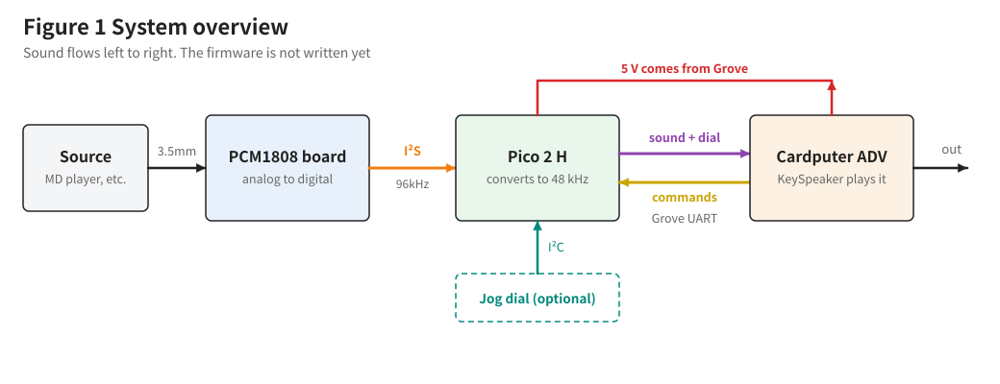
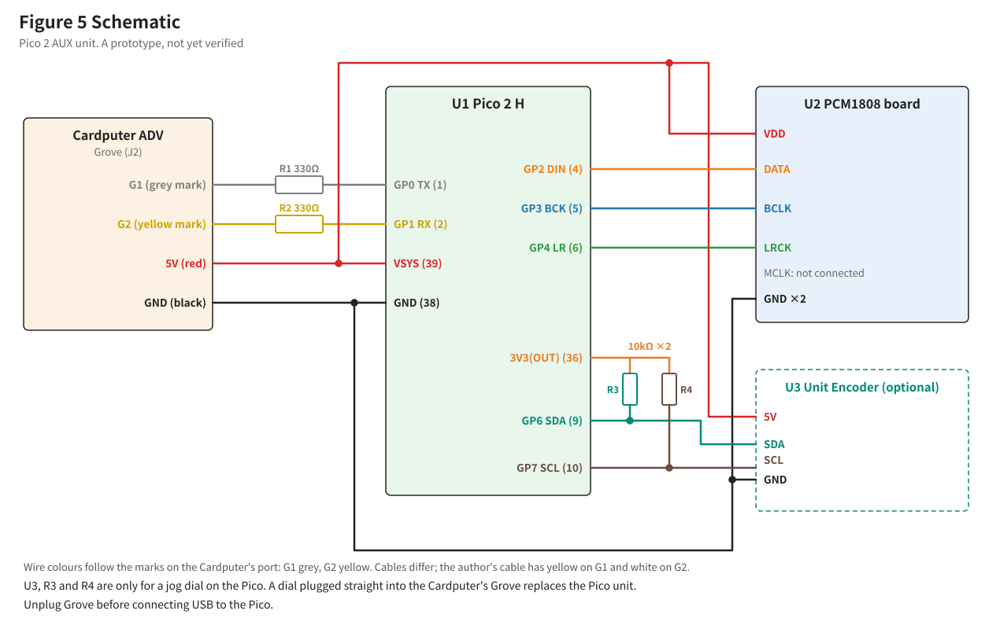
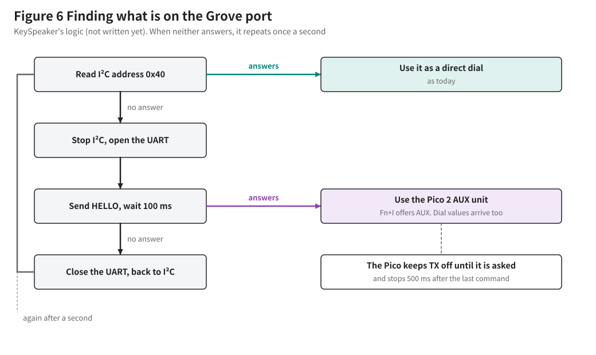

# KeySpeaker Pico 2 AUX Unit: Design

Written 2026-11-07. Status: **a prototype design. Not tried on hardware. Firmware not written.**

Japanese version: [AUX_PICO2_DESIGN_JA.md](AUX_PICO2_DESIGN_JA.md). Build guide (Japanese): [AUX_PICO2_BUILD_JA.md](AUX_PICO2_BUILD_JA.md)

Marks: ✅ confirmed in a document, 🟡 calculated or expected, ⛔ not confirmed.

## 1. Purpose

Play analog sound from an MD player or similar through the Cardputer ADV's built-in speaker. Neither the Cardputer nor Launcher is modified. The unit stays connected while Launcher starts. There is no switch to operate by hand.

A Pico 2 H is more than this job needs. Its value is that it also makes a Grove audio input unit that other projects can reuse.

## 2. The earlier design

The earlier design is kept under the name **EXT auto cut-off edition**. It connects the PCM1808 board to the EXT header and cuts it off with an SN74LV125AN. It was never built.

| Where | Name |
|---|---|
| Git tag | `aux-ext-auto-cutoff-v1` (commit a29ab81) |
| Documents | `docs/AUX_ADAPTER_BUILD_JA.md` and `docs/AUX_ADAPTER_CIRCUIT_DRAFT_JA.md` at that tag |
| PDF | `KeySpeaker_AUXアダプター製作説明書_EXT自動切り離し版.pdf` |

Why the design moved to the Pico 2:

- ✅ Launcher 2.9.1's `_setup_gpio()` drives G3, G4, G5, G6, G13 and G15 high. A PCM1808 wired straight to EXT would fight those outputs.
- ✅ Grove's G1 and G2 are not on that list.
- A Pico can stay silent until it is asked. Preventing the fight moves from parts into software.
- ✅ The wiring between the PCM1808 board and the Pico 2 H already worked in Karipom Ear. The author's unit has all five signal lines connected directly, with no resistors.

## 3. Overview

| Stage | What happens |
|---|---|
| Source to PCM1808 board | 3.5 mm cable |
| PCM1808 board to Pico | I²S. The board is master at 96 kHz (M-96K, OP1 to OP3 open). The Pico receives as slave |
| In the Pico | Takes 24-bit samples, mixes left and right, reduces to 48 kHz with a half-band FIR, makes 16-bit samples |
| Pico to Cardputer | UART on Grove |
| In the Cardputer | Enters today's playback path (ring, `playTask`, `RateAdjust`, speaker) |

## 4. Circuit

### Connections

| Line | Goes to |
|---|---|
| Grove white (G1) | R1, then Pico GP0 (pin 1, UART TX) |
| Grove yellow (G2) | R2, then Pico GP1 (pin 2, UART RX) |
| Grove red (5 V) | Pico VSYS (pin 39), PCM1808 board VDD |
| Grove black (GND) | Pico GND (pin 38), PCM1808 board GND (two places) |
| PCM1808 DATA | Direct to Pico GP2 (pin 4) |
| PCM1808 BCLK | Direct to Pico GP3 (pin 5) |
| PCM1808 LRCK | Direct to Pico GP4 (pin 6) |
| PCM1808 MCLK | Not connected |
| Dial SDA (optional) | Pico GP6 (pin 9), R3 to 3V3(OUT) (pin 36) |
| Dial SCL (optional) | Pico GP7 (pin 10), R4 to 3V3(OUT) (pin 36) |
| Dial 5 V and GND (optional) | The same lines as Grove red and black |

✅ The order GP2, GP3, GP4 is fixed by the I²S library used in Karipom Ear.

### Parts

| Ref | Part | Qty | Note |
|---|---|---|---|
| U1 | Raspberry Pi Pico 2 H | 1 | With pin headers |
| U2 | PCM1808 board | 1 | The same board as Karipom Ear |
| R1, R2 | Resistor 330 Ω 1/4 W | 2 | Protection on Grove |
| | Breadboard, 400 holes | 1 | |
| | Grove to jumper wire cable | 1 | |
| | Jumper wires | About 15 | Male-male and male-female |
| | 3.5 mm stereo cable | 1 | |
| U3 | M5Stack Unit Encoder (U135) | 1 | Optional |
| R3, R4 | Resistor 10 kΩ 1/4 W | 2 | Optional |
| | Grove to jumper wire cable (dial) | 1 | Optional |

### Why these resistors

- The three I²S lines are direct, as in the real Karipom Ear. The Pico only receives, so no two outputs meet. The 220 Ω in Karipom's documents is advice to readers and is not in the author's unit.
- The two Grove lines get 330 Ω to prevent excess current, because the other end changes from a CoreS3 to a Cardputer. If signals fight through a wiring mistake, the resistors limit the current and protect the parts. The AI first designed the circuit with 220 Ω, following the Karipom manual. The author had 330 Ω on hand, so it was changed to 330 Ω. 🟡 A bit at 2,000,000 bps lasts 500 ns. Assuming 30 pF of wiring, the time constant is about 10 ns.

R3 and R4 match the pull-ups on the Cardputer's board. ✅ Today's dial works with G1 and G2 pulled to 3.3 V through 10 kΩ. The Pico side recreates that condition.

## 5. Power

| Item | Value |
|---|---|
| Source | Grove 5 V |
| Pico 2 H | 🟡 About 30 to 50 mA (Karipom design figure) |
| PCM1808 board | 🟡 About 20 to 30 mA (Karipom design figure) |
| Dial | ✅ About 17 mA (M5Stack specification) |
| Total | 🟡 Up to about 100 mA at 5 V |
| Battery side | 🟡 About 150 mA more (assuming 3.7 V and an 85% efficient boost) |

⛔ Whether Grove has 5 V on battery alone is not confirmed. In the schematic, an internal switch SW2 selects 5VOUT or 5VIN. Check with a tester.

Unplug Grove before connecting USB to the Pico, as with Karipom Ear. On USB, VSYS (VBUS through a diode) also powers the PCM1808 board. ✅ Reception was confirmed with this wiring (section 10).

## 5.1 LINE OUT

✅ Karipom's LINE OUT takes the sound from CN3 on the PCM1808 board through 470 Ω. It runs in parallel with the sound input, so it does not affect the wiring to the Pico or the Cardputer, and it can stay in use. Even when the source's headphone jack is used, an active speaker can still play the sound.

🟡 The Cardputer's sound runs behind LINE OUT by the UART and ring delay, so playing both at once may sound out of step. Measure the delay on the device.

## 6. Protocol

UART 8N1 at **2,000,000 bps**. 🟡 If that is unstable, drop to 1,500,000 bps.

### Commands (Cardputer to Pico)

| Command | Meaning |
|---|---|
| `KS?\n` | HELLO: is a unit there? |
| `KS+\n` | Start sending sound |
| `KS-\n` | Stop sound (dial values keep coming) |

The Cardputer repeats the command for its current state every 200 ms.

### The Pico's TX pin

- After power-up, GP0 stays an input.
- It becomes a UART output only after a valid `KS?`.
- If commands stop for 500 ms, GP0 returns to an input.

Launcher sends no commands, so the Pico puts nothing on G1 while Launcher starts. When the Cardputer restarts, the Pico's output can stay on for up to 500 ms. 🟡 Launcher's `_setup_gpio()` leaves G1 alone, so nothing fights it. ⛔ Whether other Launcher code uses G1 or G2 is not confirmed. The 330 Ω in R1 and R2 also protects against that.

While the Cardputer probes I²C, meaningless signals reach the Pico's RX. The Pico ignores anything but a valid command.

### Data (Pico to Cardputer)

| Offset | Size | Content |
|---|---|---|
| 0 | 2 | Sync `A5 5A` |
| 2 | 1 | Type (1 = sound and dial, 2 = dial only, 3 = HELLO reply) |
| 3 | 1 | Sequence number |
| 4 | 1 | Dial change (signed) |
| 5 | 1 | Button (0 = up, 1 = down) |
| 6 | 2 | Sample count n |
| 8 | 2n | Samples (16-bit, little-endian, mono) |
| 8+2n | 2 | CRC-16 |

Sound goes out as 240 samples (480 bytes) every 5 ms. A frame is 490 bytes, 200 times a second: 🟡 980,000 bps, about 49% of 2,000,000 bps.

While sound is stopped, type 2 goes out every 20 ms. A frame with a bad CRC is dropped and its time is filled with silence.

## 7. KeySpeaker's side (not written)

### Detection

Today's `dialService()` looks for a missing dial once a second. The Pico check joins that flow. G1 and G2 cannot carry I²C and UART at once, so only the one that was found stays open.

| On the Grove port | Behaviour |
|---|---|
| Dial | As today, read over I²C |
| Pico 2 AUX unit | Received over UART |
| Pico 2 AUX unit with dial | Sound and dial received over UART |
| Nothing | Looks once a second |

Change what is on Grove only with the power off.

### The dial

`dialService()` splits in two. Reading the values gets two forms, I²C and UART. Turning rotation and the button into actions stays shared, so the dial behaves the same.

### Choosing the input

`Fn+I` switches between USB audio and the microphone today. AUX joins the choices only when a unit is found: USB audio, microphone, AUX. `Fn+A` is not used. The choice is saved the way the microphone setting is.

While AUX is selected, USB audio is dropped and only AUX sound enters the ring.

### Clock difference

🟡 The PCM1808 board and the ESP32-S3 have separate crystals. `RateAdjust`'s ±200 ppm should absorb the difference.

## 8. The Pico's side (not written)

- ✅ I²S reception starts from `KariPom/pico2-pcm1808/karipom_pico2/karipom_pico2.ino` (setSlave, 32-bit, sync check).
- 🟡 FFT and text output are replaced by the FIR and UART frames.
- 🟡 DMA or both cores keep reception and sending from blocking each other. To be decided during implementation.
- The dial is read every 20 ms: I²C1 (`Wire1`), 100 kHz, address 0x40, registers 0x10 (rotation) and 0x20 (button).
- A missing dial does not stop the sound.

## 9. Stages

| Stage | Work | Check |
|---|---|---|
| S12-1 | 96 kHz to 48 kHz on the Pico | USB serial values, GP0-GP1 loopback |
| S12-2 | UART to the Cardputer | CRC errors and lost frames over 10 minutes |
| S12-3 | Play sound | Listen for noise, dropouts and delay |
| S12-4 | Dial through the Pico | Both connections and detection |
| S12-5 | Battery use | Grove 5 V, running time |

## 10. Not confirmed

✅ Confirmed 2026-11-07: I²S reception from the PCM1808 board on the Pico 2 H. On a breadboard, wired directly with no resistors, on USB power, with `firmware/aux_pico2_check/aux_pico2_check.uf2`: `n=96000 mis=0 ovf=0 fft/s=25`.

1. ⛔ Whether Grove can carry sound continuously at 2,000,000 bps, including the effect of G1's TVS and pull-up.
2. ⛔ Sound quality. Karipom Ear only analysed sound and nobody listened to it. Listen for Pico noise.
3. ⛔ Grove 5 V on battery.
4. ⛔ That Launcher does not use G1 or G2 outside `_setup_gpio()`.
5. ⛔ The dial's signal voltage (expected at or below 3.3 V, since it works with an ESP32-S3). Measure before connecting.
6. ⛔ Grove cable colours. They can differ by lot, so check with a tester.

## 11. Sources

- Karipom: `KariPom/docs/pcm1808_pico2/PCM1808_Pico2_設計マニュアル.md`, `KariPom/docs/karipom_ear/Step1確認手順書_v1.1.md`
- Unit Encoder: [M5Stack documentation](https://docs.m5stack.com/en/unit/encoder)
