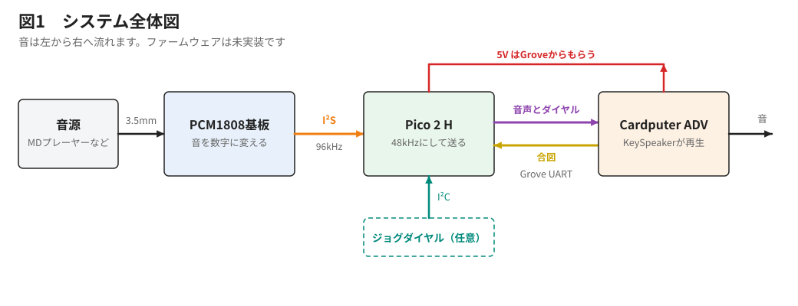
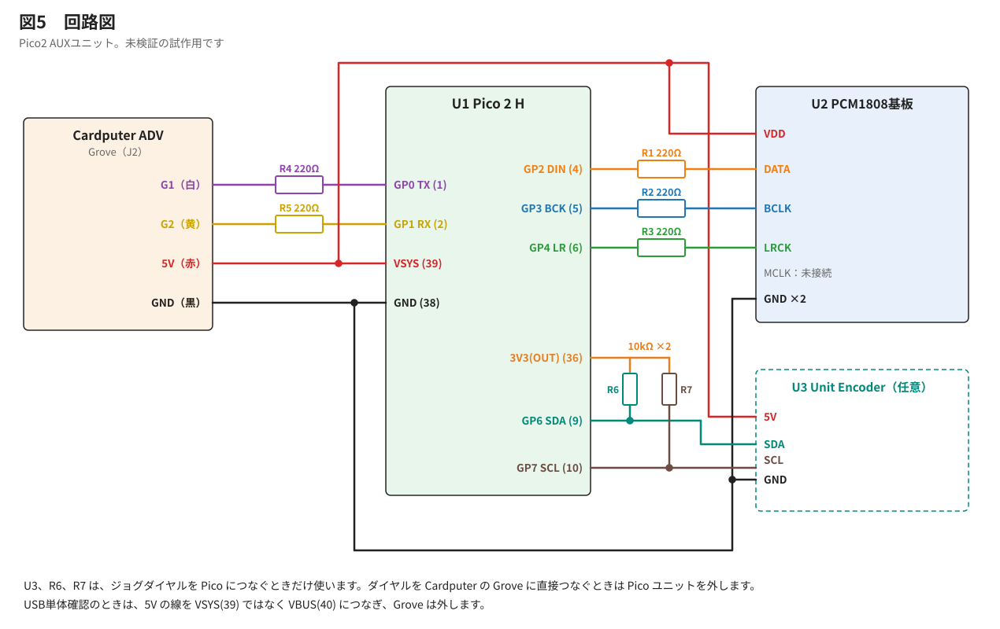
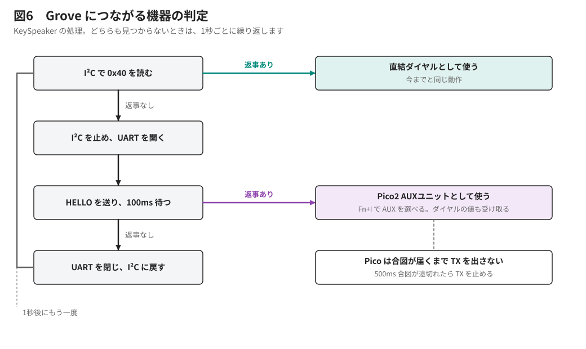

# KeySpeaker Pico2 AUXユニット 設計書

作成日：2026-11-07　状態：**試作用の設計。実機未検証。ファームウェア未実装。**

英語版：[AUX_PICO2_DESIGN.md](AUX_PICO2_DESIGN.md)　製作手順：[AUX_PICO2_BUILD_JA.md](AUX_PICO2_BUILD_JA.md)

マークの意味：✅ 資料で確認、🟡 計算や予想、⛔ 未確認。

## 1. 目的

MDプレーヤーなどのアナログ音を、Cardputer ADV の内蔵スピーカーで鳴らします。本体と Launcher は改造しません。ユニットは、Launcher の起動中もつないだままにします。手で操作するスイッチは使いません。

Pico 2 H は、この用途だけなら機能が余ります。Grove につなぐ音声入力ユニットとして、ほかの企画にも使い回せることを価値に数えます。

## 2. 前の設計との関係

前の設計は **EXT自動切り離し版** という名前で残します。PCM1808 基板を EXT 端子につなぎ、SN74LV125AN で切り離す方式です。製作はしていません。

| 残し場所 | 名前 |
|---|---|
| Git タグ | `aux-ext-auto-cutoff-v1`（コミット a29ab81） |
| 資料 | そのタグの `docs/AUX_ADAPTER_BUILD_JA.md`、`docs/AUX_ADAPTER_CIRCUIT_DRAFT_JA.md` |
| PDF | `KeySpeaker_AUXアダプター製作説明書_EXT自動切り離し版.pdf` |

Pico2 に変えた理由は次のとおりです。

- ✅ Launcher 2.9.1 の `_setup_gpio()` は、G3、G4、G5、G6、G13、G15 を High 出力にします。EXT に PCM1808 をじかにつなぐと、出力どうしがぶつかります。
- ✅ Grove の G1、G2 は、このリストにありません。
- Pico は、頼まれるまで信号を出さないように作れます。ぶつかりを防ぐ役目を、部品からプログラムへ移せます。
- ✅ PCM1808 基板と Pico 2 H の配線は、かりぽむ Ear で動いた実績があります。作者の実機は、信号線5本とも抵抗なしの直結です。

## 3. 全体の構成

| 区間 | 内容 |
|---|---|
| 音源 → PCM1808 基板 | 3.5mm ケーブル |
| PCM1808 基板 → Pico | I²S。基板がマスターで 96kHz（M-96K、OP1〜3 は開放）。Pico はスレーブ受信 |
| Pico の中 | 24bit を受け取り、左右を混ぜ、ハーフバンド FIR で 48kHz にして、16bit にする |
| Pico → Cardputer | Grove の UART |
| Cardputer の中 | 今の再生処理（リング → `playTask` → `RateAdjust` → スピーカー）に入れる |

## 4. 回路

### 接続

| 線 | つながる先 |
|---|---|
| Grove 白（G1） | R1 → Pico GP0（1番、UART TX） |
| Grove 黄（G2） | R2 → Pico GP1（2番、UART RX） |
| Grove 赤（5V） | Pico VSYS（39番）、PCM1808 基板 VDD |
| Grove 黒（GND） | Pico GND（38番）、PCM1808 基板 GND（2か所） |
| PCM1808 DATA | Pico GP2（4番）に直結 |
| PCM1808 BCLK | Pico GP3（5番）に直結 |
| PCM1808 LRCK | Pico GP4（6番）に直結 |
| PCM1808 MCLK | 未接続 |
| ダイヤル SDA（任意） | Pico GP6（9番）、R3 → 3V3(OUT)（36番） |
| ダイヤル SCL（任意） | Pico GP7（10番）、R4 → 3V3(OUT)（36番） |
| ダイヤル 5V、GND（任意） | Grove 赤、Grove 黒と同じ線 |

✅ GP2、GP3、GP4 の順番は、かりぽむ Ear で使った I²S ライブラリの決まりです。入れ替えられません。

### 部品表

| 記号 | 部品 | 数 | 備考 |
|---|---|---|---|
| U1 | Raspberry Pi Pico 2 H | 1 | ピンヘッダー付き |
| U2 | PCM1808 基板 | 1 | かりぽむ Ear と同じ基板 |
| R1、R2 | 抵抗 330Ω 1/4W | 2 | Grove の保護 |
| | ブレッドボード 400穴 | 1 | |
| | Grove とジャンパー線の変換ケーブル | 1 | |
| | ジャンパー線 | 約15本 | オス–オス、オス–メス |
| | 3.5mm ステレオケーブル | 1 | |
| U3 | M5Stack Unit Encoder（U135） | 1 | 任意 |
| R3、R4 | 抵抗 10kΩ 1/4W | 2 | 任意 |
| | Grove 変換ケーブル（ダイヤル用） | 1 | 任意 |

### 抵抗の考え方

- I²S の3本は、かりぽむ Ear の実機と同じ直結です。Pico は受信だけなので、出力どうしはぶつかりません。かりぽむの資料にある 220Ω は、読者への保護のおすすめで、作者の実機には入っていません。
- Grove の2本は、相手が CoreS3 から Cardputer に変わるので、過電流を防ぐ 330Ω を入れます。配線ミスなどで信号がぶつかったときに、電流を抑えて部品を守るためのものです。AIはかりポムのマニュアルを参考に220Ωで回路を設計しましたが、作者の手持ちが330Ωだったので、330Ωに変更しました。🟡 2,000,000bps の1ビットは 500ns で、配線の容量を 30pF と仮定すると、時定数は約10ns です。

R3、R4 の 10kΩ は、Cardputer 基板のプルアップと同じ値です。✅ 今のダイヤルは、G1、G2 が 10kΩ で 3.3V に引かれた状態で動いています。同じ条件を Pico 側に作ります。

## 5. 電源

| 項目 | 値 |
|---|---|
| 電源 | Grove の 5V |
| Pico 2 H | 🟡 約30〜50mA（かりぽむの設計値） |
| PCM1808 基板 | 🟡 約20〜30mA（かりぽむの設計値） |
| ダイヤル | ✅ 約17mA（M5Stack の仕様） |
| 合計 | 🟡 最大 約100mA（5V 側） |
| 電池側 | 🟡 約150mA 増（電池 3.7V、昇圧効率 85% と仮定） |

⛔ 電池だけで動かすとき、Grove に 5V が出るかは未確認です。回路図では、内部スイッチ SW2 で 5VOUT と 5VIN を選ぶ作りです。テスターで確かめます。

Pico に USB をつなぐときは、Grove を外します。かりぽむ Ear と同じ運用です。USB で動かすときは、VBUS からダイオードを通った VSYS で PCM1808 基板も動きます。✅ この配線で受信を確認しました（10章）。

## 5.1 LINE OUT

✅ かりぽむの LINE OUT は、PCM1808 基板の CN3 から 470Ω を通して音を取り出します。音の入口と並列なので、Pico と Cardputer の配線に影響しません。そのまま残して使えます。音源のイヤホン端子を使っても、アクティブスピーカーで音を聴けます。

🟡 Cardputer の音は、UART とリングの分だけ LINE OUT より遅れます。同時に鳴らすと、ずれて聞こえることがあります。遅れの量は実機で確かめます。

## 6. 通信の決まり

UART は 8N1、**2,000,000bps** です。🟡 不安定なら 1,500,000bps に下げます。

### 合図（Cardputer → Pico）

| 合図 | 意味 |
|---|---|
| `KS?\n` | HELLO。つながっているか尋ねる |
| `KS+\n` | 音を送り始める |
| `KS-\n` | 音を止める（ダイヤルの値は送り続ける） |

Cardputer は、今の状態の合図を 200ms ごとに送り直します。

### Pico の TX の扱い

- 電源が入った直後の GP0 は、入力のままです。
- 正しい `KS?` を受けてから、UART の出力にします。
- 合図が 500ms 途切れたら、GP0 を入力に戻します。

Launcher は合図を送らないので、Launcher の起動中に Pico は G1 へ信号を出しません。Cardputer が再起動したときは、最大 500ms の間、Pico が出力のままです。🟡 Launcher の `_setup_gpio()` は G1 を触らないので、ぶつかりません。⛔ Launcher のほかの処理が G1、G2 を使わないかは未確認です。R1、R2 の 330Ω は、そのときの保護にもなります。

Cardputer の I²C の確認中に、Pico の RX へ意味のない信号が届きます。Pico は、正しい合図以外を無視します。

### データ（Pico → Cardputer）

| 位置 | 大きさ | 内容 |
|---|---|---|
| 0 | 2 | 目印 `A5 5A` |
| 2 | 1 | 種類（1＝音とダイヤル、2＝ダイヤルだけ、3＝HELLO の返事） |
| 3 | 1 | 通し番号 |
| 4 | 1 | ダイヤルの変化量（符号付き） |
| 5 | 1 | ボタン（0＝離す、1＝押す） |
| 6 | 2 | 音の数 n |
| 8 | 2n | 音（16bit、リトルエンディアン、モノラル） |
| 8+2n | 2 | CRC-16 |

音は 5ms ごとに 240個（480バイト）送ります。1フレーム 490バイト、毎秒 200回で、🟡 980,000bps です。2,000,000bps の約49%です。

音を止めている間は、種類2を 20ms ごとに送ります。CRC が合わないフレームは捨てて、その分は無音にします。

## 7. KeySpeaker の処理（未実装）

### 機器の判定

今の `dialService()` は、ダイヤルがないとき、1秒ごとに探します。この流れに Pico の確認を足します。G1、G2 は I²C と UART で同時に使えないので、見つかった側だけを開いたままにします。

| Grove につないだもの | 動作 |
|---|---|
| ダイヤル | 今までと同じ。I²C で読む |
| Pico2 AUXユニット | UART で受ける |
| Pico2 AUXユニット＋ダイヤル | UART で音とダイヤルを受ける |
| 何もなし | 1秒ごとに探す |

Grove の差し替えは、電源を切ってから行います。

### ダイヤルの処理

`dialService()` を2つに分けます。値を読む部分は I²C と UART の2通りにします。回転とボタンを操作に変える部分は共通にします。ダイヤルの動きは同じになります。

### 入力の切り替え

`Fn+I` は、今は USB 音声とマイクを切り替えています。ユニットが見つかったときだけ、AUX を選択肢に足します。USB 音声 → マイク → AUX の順です。`Fn+A` は使いません。選んだ入力は、今のマイクと同じように保存します。

AUX を選んでいる間は、USB の音を止めて、AUX の音だけをリングに入れます。

### 速度のずれ

🟡 PCM1808 基板の水晶と ESP32-S3 の水晶は別です。`RateAdjust` の ±200ppm で吸収できる見込みです。

## 8. Pico の処理（未実装）

- ✅ I²S の受信は `KariPom/pico2-pcm1808/karipom_pico2/karipom_pico2.ino` を土台にします（setSlave、32bit、同期の確認）。
- 🟡 FFT と文字の送信は外し、FIR と UART のフレーム送信に入れ替えます。
- 🟡 受信と送信を止めないよう、DMA か2つのコアを使います。実装のときに決めます。
- ダイヤルは 20ms ごとに読みます。I²C1（`Wire1`）、100kHz、アドレス 0x40、レジスタ 0x10（回転）と 0x20（ボタン）です。
- ダイヤルが見つからなくても、音の処理は止めません。

## 9. 開発の段階

| 段階 | 内容 | 確認 |
|---|---|---|
| S12-1 | Pico で 96kHz を 48kHz にする | USB シリアルの値、GP0–GP1 の折り返し |
| S12-2 | Cardputer への UART | 10分で CRC 誤りと欠けの数 |
| S12-3 | 音を鳴らす | 耳で聴く。ノイズ、音切れ、遅れ |
| S12-4 | ダイヤルを Pico 経由にする | 2通りのつなぎ方と自動判定 |
| S12-5 | 電池で動かす | Grove の 5V、動作時間 |

## 10. 未確認の点

✅ 確認済み（2026-11-07）：PCM1808 基板から Pico 2 H への I²S 受信。ブレッドボードで抵抗なしの直結、USB 給電、`firmware/aux_pico2_check/aux_pico2_check.uf2` で、`n=96000 mis=0 ovf=0 fft/s=25` でした。

1. ⛔ Grove で音を 2,000,000bps で送り続けられるか。G1 の TVS やプルアップの影響も含みます。
2. ⛔ 音質。かりぽむ Ear は解析に使っただけで、音を耳で確かめていません。Pico のノイズが音に乗らないかを聴きます。
3. ⛔ 電池のときの Grove の 5V。
4. ⛔ Launcher が G1、G2 を使わないこと（`_setup_gpio()` 以外）。
5. ⛔ ダイヤルの信号電圧（ESP32-S3 で動いている実績から、3.3V 以下と予想）。接続前に測ります。
6. ⛔ Grove ケーブルの色と信号の対応。ロットで違うことがあるので、テスターで確かめます。

## 11. 出典

- かりぽむ：`KariPom/docs/pcm1808_pico2/PCM1808_Pico2_設計マニュアル.md`、`KariPom/docs/karipom_ear/Step1確認手順書_v1.1.md`
- Unit Encoder：[M5Stack 公式資料](https://docs.m5stack.com/en/unit/encoder)
