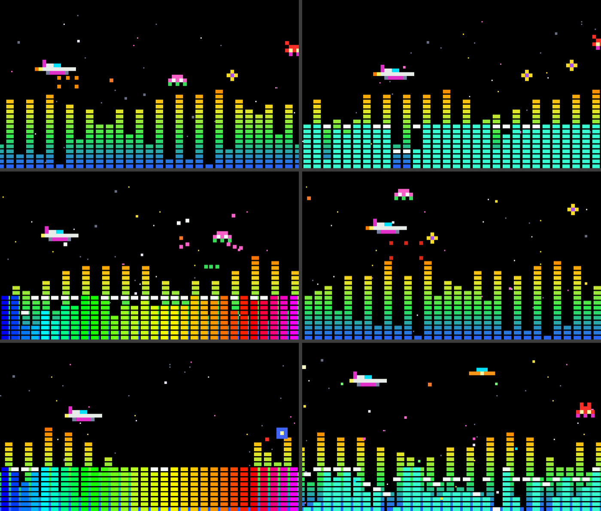
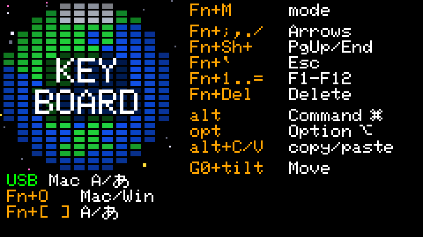
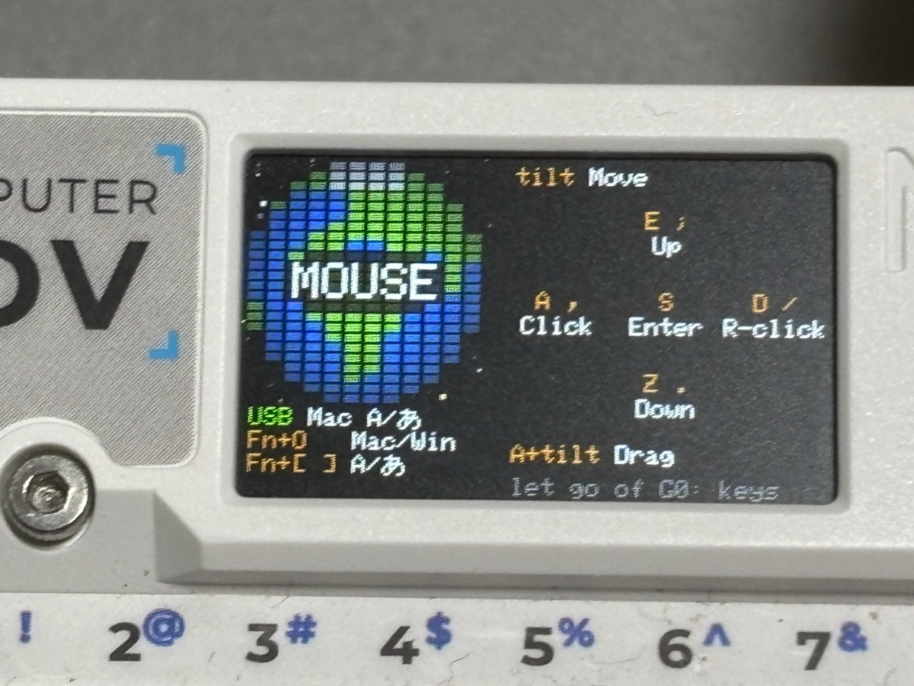
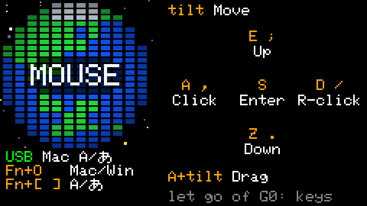

# KeySpeaker screens

[日本語版](SCREENS_JA.md)

A summary of what the Cardputer ADV's screen (240 x 135 px) shows, as of S5-13 (2026-11-01). The details and the
history of each decision are in [`DESIGN.md`](DESIGN.md) 8.3 to 8.3.2. Many of the looks below were the user's
ideas; they are marked "(the user's idea)".

The photos are of the device running S5-13. The other pictures are drawn on a computer, from previews and mockups
made during development, so small details can differ from the current build; they show what a photo cannot catch
(several flight moments, sharp text).

## Common rules

- **Colors:** keys in amber, their meanings in white. Status: green when ready, yellow while waiting, red for a
  problem. Help text in dim gray.
- **Blocks:** the Earth, the terrain and the graphic equalizer are all drawn with the same 6 x 3 px blocks (8 px
  across, 4 px down), so the screens look like one family (the user's judgment).
- **Stars:** flight mode and keyboard mode share one star sky: black, mostly white stars with some yellow
  and pink, a few white ones twinkling.
- **Fonts:** the Cardputer's built-in font. "あ", which it lacks, is pixel art made from Hiragino.

## Modes

`Fn+M` cycles **measure mode → flight mode → keyboard mode**, the names the help screen uses; the last one is
remembered. Without USB, the keyboard screen is shown first, and `Fn+M` then moves to the others (S10-7); with the
microphone as the input (`Fn+I`) they are there from the start.

## Start screen and the resting emblem

- KariPom's metal emblem on a full-screen speaker grille, for 2 seconds at start (a key skips it). Not a mode: seen
  now and then, it stays fun.
- The grille is perforated metal with round holes, so it reads as a speaker (the user's call from mockups, S5-13).
- At start, "KeySpeaker" under the emblem, large, white with a dark shadow (the user's idea, S5-13).
- The emblem is at 80 % of its original size, so the grille is the main thing, as on a real speaker. It is plain
  silver, like a speaker badge (the user's judgment, S2-8).
- At rest, at the bottom, on a darker strip of grille: `h HELP  Fn+M KEYBOARD` (keys in amber). Not at start: USB is
  still coming up then, so those keys would not work yet (S5-13).
- **Resting:** in measure mode, after a minute with no key and no sound, the emblem comes back, like a speaker at rest.
  It stays until a key is pressed; that key only wakes the screen. Flight mode stays as it is, to be watched (S5-14).
- **Shaking:** the emblem jumps 1 px (2 px on very loud beats) on loud beats and settles back within 0.1 s, like a
  speaker's cone (the user's idea, S2-7). So a resting speaker starts to shake when the music comes back.

## Measure mode

The measurement screen from S0, kept for checking how the speaker runs.

- Top: `KeySpeaker` in amber, the build (for example `S5-13`) at the top right.
- The USB state: green when streaming, yellow when connected but idle, red when not connected.
- The buffer as a bar, the clock drift correction, the counters (underruns in red), the volume, and level meters
  for what comes in and what goes out.
- Bottom, dim: `[ ]\ vol  spc play  v view  h help`.

## Flight mode

A screen saver to watch while music plays, not a game: no score, nothing to lose.

*Moving, 3 seconds. Recorded on an earlier build, which still showed the status line at the top.*

- The music's level is the terrain, drawn like an LED level meter, blue at the bottom through green, yellow and
  orange to red, scrolling left.
- A small fighter (original pixel art in the style of early-80s arcade games) flies over it, fires a laser and drops
  bombs that leave small craters. Beats bring in harmless targets of six kinds that the fighter shoots (in silence, one every 6 seconds, S5-15); they pop in
  colored sparks. They shoot back now and then; a hit only lights up the fighter's shield.
- While music plays (after about 3 seconds of sound), a space monster, the beast from the Space Invaders cabinet art
  (black and red, lit from the left, glowing yellow eyes, 69 x 90 px), now and then walks in from the right behind the
  terrain and reaches for the fighter with a clawed hand drawn in front of everything. The fighter slips away, the hand
  closes on nothing, and the monster draws its arm back and walks off (S9-1; designed in the web demo first).
  Half of the visits are a second monster instead (S11-1), a Space Invaders squid of the same size: a pointed head with slanted eyes and a
  small grumpy mouth over seven tentacles that hang side by side and lie out along the ground. It floats in, and before the fighter passes
  and again after it has passed it may stretch the two tentacles on the fighter's side (now and then the other two as well) toward it.
- Searchlights (S11-2): a city on alert. Up to three stand on the ground, each with a small base (a light grey square with a blue window),
  flow from right to left with the terrain and sweep the sky with a slim beam. A beam stops at a monster's centre line and on the
  fighter. They come only while music plays, one every 10 to 35 seconds, and are on screen about 60 % of the time.
- Now and then a graphic equalizer like an old hi-fi's rises in front of the terrain: 30 bands with falling peak
  dots, in the aqua of a fluorescent display or in KariPom's colors. The patterns take turns every minute.
- Nothing else on it while all is well: a line at the top shows only when something is wrong (`not connected` in
  red, `MUTE` in yellow, dropout counters in red), so the terrain stays the main thing (the user's call, S5-13).

## Help screen

- `h` (or any key with no job) opens it in measure mode and flight mode; it lists the speaker and playback keys, keys in
  amber, meanings in white (the user's idea: easier to read than a hint that vanishes after 2 seconds).
- While it is open, the keys with a job still work, so you can read and try at the same time. Not shown in keyboard
  mode, where every key goes to the computer.

## Keyboard screen

Quiet on purpose: flight mode is busy, so this one is calm. Nothing flashes when a key is pressed.

  
  

*Left: a photo of the device. Right: drawn on a computer.*

**The Earth (top left, about 96 px square)**

- 12 x 24 blocks: sea blue, land green, polar regions white, darker toward the rim, seen from 20 degrees north.
  The land is a coarse, hand-made map that fits the blocks.
- It turns once a minute, the land flowing from left to right as on the real Earth, with Japan in front at start.
  It links to flight mode's "defending the Earth" theme.
- **KEY BOARD** in large white letters over it (the user's idea). Behind the letters, the Earth is dimmed to a third
  of its brightness, in whole blocks: 6 blocks wide behind `KEY`, 8 behind `BOARD`, so the corners beside `KEY` stay
  bright (the user's idea, S2-12). The outer corner block above `KEY` and below `BOARD` is left out, so the dark
  part has rounded corners (the user's idea, S2.5-5).

**Under the Earth (9 px between lines)**

- The connection, the OS profile and the input: for example `USB Mac A/あ`. The connection is `USB` or `BLE` in
  green when ready, `BLE wait` in yellow while waiting for a computer. `A/あ` is always shown; the last one switched
  with `Fn+[` / `Fn+]` is amber, like the Mac's menu bar shows it (both white at start, since the Mac does not tell).
- `Fn+O Mac/Win` and `Fn+[ ] A/あ`, next to what they change (the user's idea).
- Without USB: `Off+Reset to USB` at the bottom left, the way back to USB (5.3).

**Right side (9 px between lines)**

- `Fn+M mode` at the top right, since it works in every mode (the user's idea; S10-7: also without USB), and `Fn+I USB/MIC`
  under it (S10-8).
- While the microphone is the input, a green `MIC` in the bottom left corner, just above the connection, where the round
  Earth leaves room (S10-9). The green `USB` below it only says the cable is connected.
- The cheat sheet of the keyboard mode's own keys: arrows, PgUp/End, Esc, F1-F12, Delete, `alt` / `opt` with
  their role for the chosen OS, copy/paste, and `G0+tilt Move`.
- Next to Command and Option, 7 x 7 px icons: ⌘ and ⌥ on a Mac, four window panes next to Win on Windows (not the
  Windows logo itself) (the user's idea, S2-11).

**While G0 is held (the air mouse)**

  
  

*Left: a photo of the device. Right: drawn on a computer.*

- The Earth says **MOUSE** instead (dimmed the same way, all four corner blocks left out), and the right side shows
  the mouse keys at once; letting go of G0 brings the keyboard back (the user's idea, S2.5-7).
- The keys are laid out as a cross, the way `E` `Z` `A` `D` sit around `S`: Up above, Down below, Click left,
  R-click right, Enter in the middle (the user's idea, S2.5-8). Above the cross `tilt Move`, below it `A+tilt Drag`
  and `let go of G0: keys`.

## Not built yet

- A gray Earth while BLE waits for a computer, colored once connected (planned in `DESIGN.md` 8.3). The current
  build keeps the Earth in color and shows `BLE wait` in yellow instead.
- S7, a retro-device look for the whole design, is still open; the screens above already go a long way toward it.
