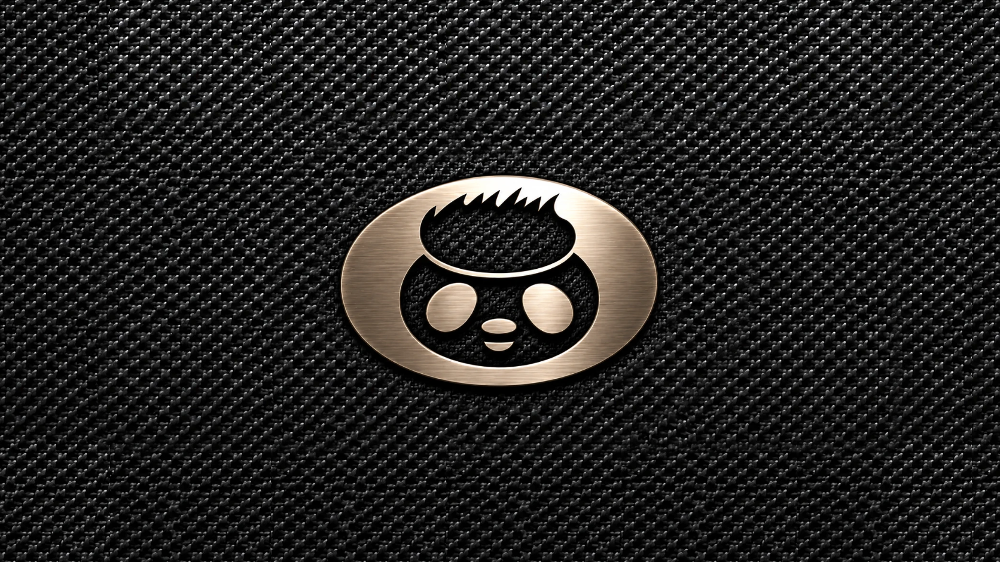

# KeySpeaker screens

[日本語版](SCREENS_JA.md)

A summary of what the Cardputer ADV's screen (240 x 135 px) shows, as of S5-12 (2026-11-01). The details and the
history of each decision are in [`DESIGN.md`](DESIGN.md) 8.3 to 8.3.2. Many of the looks below were the user's
ideas; they are marked "(the user's idea)".

The pictures are previews drawn on a computer from the screens' code and its mockups during development, not photos
of the device; small details can differ from the current build.

## Common rules

- **Colors:** keys in amber, their meanings in white. Status: green when ready, yellow while waiting, red for a
  problem. Help text in dim gray.
- **Blocks:** the Earth, the terrain and the graphic equalizer are all drawn with the same 6 x 3 px blocks (8 px
  across, 4 px down), so the screens look like one family (the user's judgment).
- **Stars:** the game screen and the keyboard screen share one star sky: black, mostly white stars with some yellow
  and pink, a few white ones twinkling.
- **Fonts:** the Cardputer's built-in font. "あ", which it lacks, is pixel art made from Hiragino.

## Modes

`Fn+M` cycles **Data → Game → Keyboard**; the last one is remembered. Without USB, only the keyboard screen is
shown and `Fn+M` does nothing.

## Start screen and the resting emblem

- KariPom's metal emblem on a full-screen speaker grille, for 2 seconds at start (a key skips it). Not a mode: seen
  now and then, it stays fun.
- The emblem is at 80 % of its original size, so the grille is the main thing, as on a real speaker. It is plain
  silver, like a speaker badge (the user's judgment, S2-8).
- At the bottom, on a darker strip of grille: `h HELP  Fn+M KEYBOARD` (keys in amber). At start in keyboard mode:
  only `Fn+M MODE`.
- **Resting:** in the Data and Game modes, after a minute with no key and no sound, the emblem comes back, like a
  speaker at rest. It stays until a key is pressed; that key only wakes the screen.
- **Shaking:** the emblem jumps 1 px (2 px on very loud beats) on loud beats and settles back within 0.1 s, like a
  speaker's cone (the user's idea, S2-7). So a resting speaker starts to shake when the music comes back.

## Data screen

The measurement screen from S0, kept for checking how the speaker runs.

- Top: `KeySpeaker S0` in amber, the build (for example `S5-12`) at the top right.
- The USB state: green when streaming, yellow when connected but idle, red when not connected.
- The buffer as a bar, the clock drift correction, the counters (underruns in red), the volume, and level meters
  for what comes in and what goes out.
- Bottom, dim: `[ ]\ vol  spc play  v view  h help`.

## Game screen

A screen saver to watch while music plays, not a game: no score, nothing to lose.

- The music's level is the terrain, drawn like an LED level meter, blue at the bottom through green, yellow and
  orange to red, scrolling left.
- A small fighter (original pixel art in the style of early-80s arcade games) flies over it, fires a laser and drops
  bombs that leave small craters. Beats bring in harmless targets of six kinds that the fighter shoots; they pop in
  colored sparks. They shoot back now and then; a hit only lights up the fighter's shield.
- Now and then a graphic equalizer like an old hi-fi's rises in front of the terrain: 30 bands with falling peak
  dots, in the aqua of a fluorescent display or in KariPom's colors. The patterns take turns every minute.
- The status line at the top is small and dim, so the terrain stays the main thing.

## Help screen

- `h` (or any key with no job) opens it in the Data and Game modes; it lists the speaker and playback keys, keys in
  amber, meanings in white (the user's idea: easier to read than a hint that vanishes after 2 seconds).
- While it is open, the keys with a job still work, so you can read and try at the same time. Not shown in keyboard
  mode, where every key goes to the computer.

## Keyboard screen

Quiet on purpose: the game screen is busy, so this one is calm. Nothing flashes when a key is pressed.

**The Earth (top left, about 96 px square)**

- 12 x 24 blocks: sea blue, land green, polar regions white, darker toward the rim, seen from 20 degrees north.
  The land is a coarse, hand-made map that fits the blocks.
- It turns once a minute, the land flowing from left to right as on the real Earth, with Japan in front at start.
  It links to the game screen's "defending the Earth" theme.
- **KEY BOARD** in large white letters over it (the user's idea). Behind the letters, the Earth is dimmed to a third
  of its brightness, in whole blocks: 6 blocks wide behind `KEY`, 8 behind `BOARD`, so the corners beside `KEY` stay
  bright (the user's idea, S2-12). The outer corner block above `KEY` and below `BOARD` is left out, so the dark
  part has rounded corners (the user's idea, S2.5-5).

**Under the Earth (9 px between lines)**

- The connection, the OS profile and the input: for example `USB Mac A/あ`. The connection is `USB` or `BLE` in
  green when ready, `BLE wait` in yellow while waiting for a computer. `A/あ` is always shown; the last one switched
  with `Fn+[` / `Fn+]` is amber, like the Mac's menu bar shows it (both white at start, since the Mac does not tell).
- `Fn+O Mac/Win` and `Fn+[ ] A/あ`, next to what they change (the user's idea).
- Without USB: `Off+Reset to USB` at the bottom left, the way back to USB (5.3).

**Right side (9 px between lines)**

- `Fn+M mode` at the top right, since it works in every mode, shown only over USB (the user's idea).
- The cheat sheet of the keyboard mode's own keys: arrows, PgUp/End, Esc, F1-F12, Delete, `alt` / `opt` with
  their role for the chosen OS, copy/paste, and `G0+tilt Move`.
- Next to Command and Option, 7 x 7 px icons: ⌘ and ⌥ on a Mac, four window panes next to Win on Windows (not the
  Windows logo itself) (the user's idea, S2-11).

**While G0 is held (the air mouse)**

- The Earth says **MOUSE** instead (dimmed the same way, all four corner blocks left out), and the right side shows
  the mouse keys at once; letting go of G0 brings the keyboard back (the user's idea, S2.5-7).
- The keys are laid out as a cross, the way `E` `Z` `A` `D` sit around `S`: Up above, Down below, Click left,
  R-click right, Enter in the middle (the user's idea, S2.5-8). Above the cross `tilt Move`, below it `A+tilt Drag`
  and `let go of G0: keys`.

**Diagnostics (bottom right, without USB)**

- `k m ok ng rc`: the keyboard and mouse subscriptions, reports sent and refused, the last error code. `uac ok NNk`:
  whether USB audio started, and free memory. For development; they may go before release.

## Not built yet

- A gray Earth while BLE waits for a computer, colored once connected (planned in `DESIGN.md` 8.3). The current
  build keeps the Earth in color and shows `BLE wait` in yellow instead.
- S7, a retro-device look for the whole design, is still open; the screens above already go a long way toward it.
