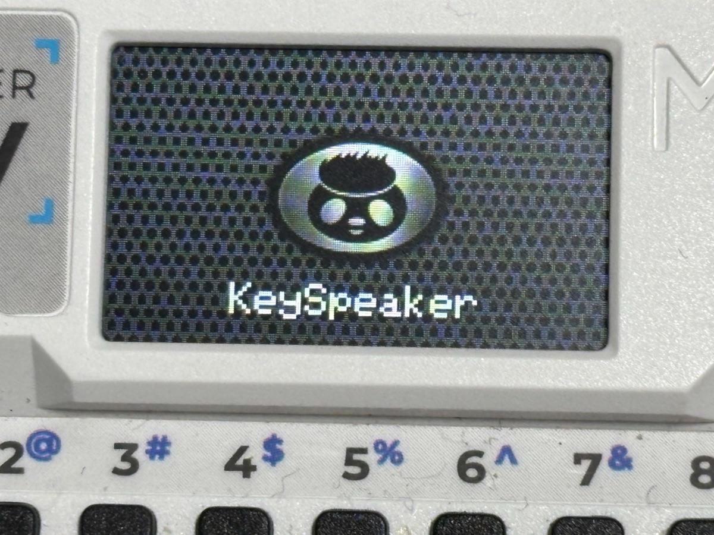
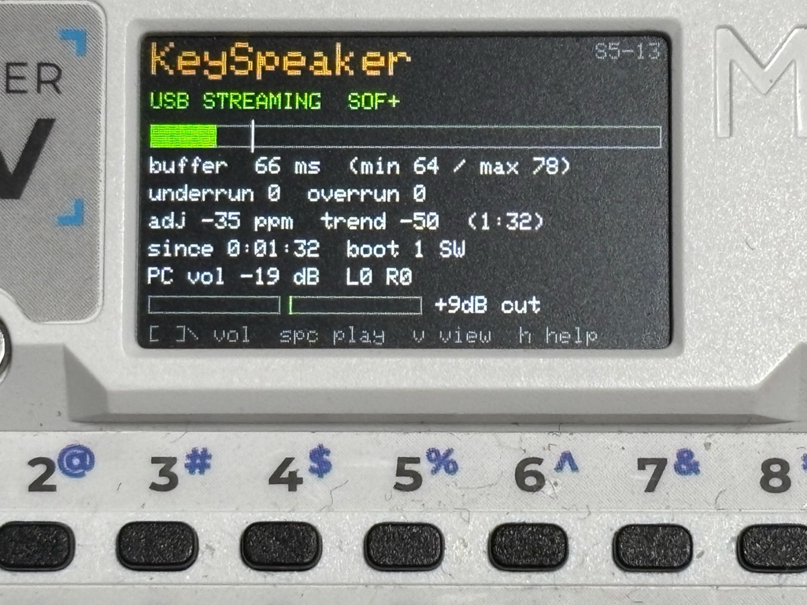
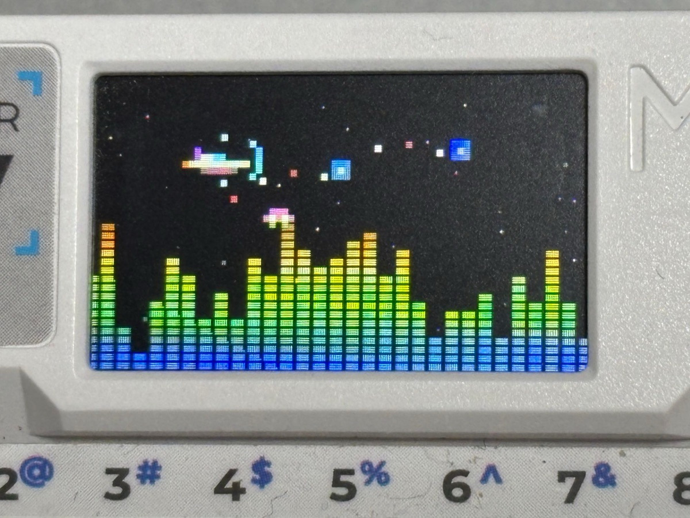
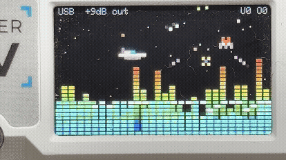
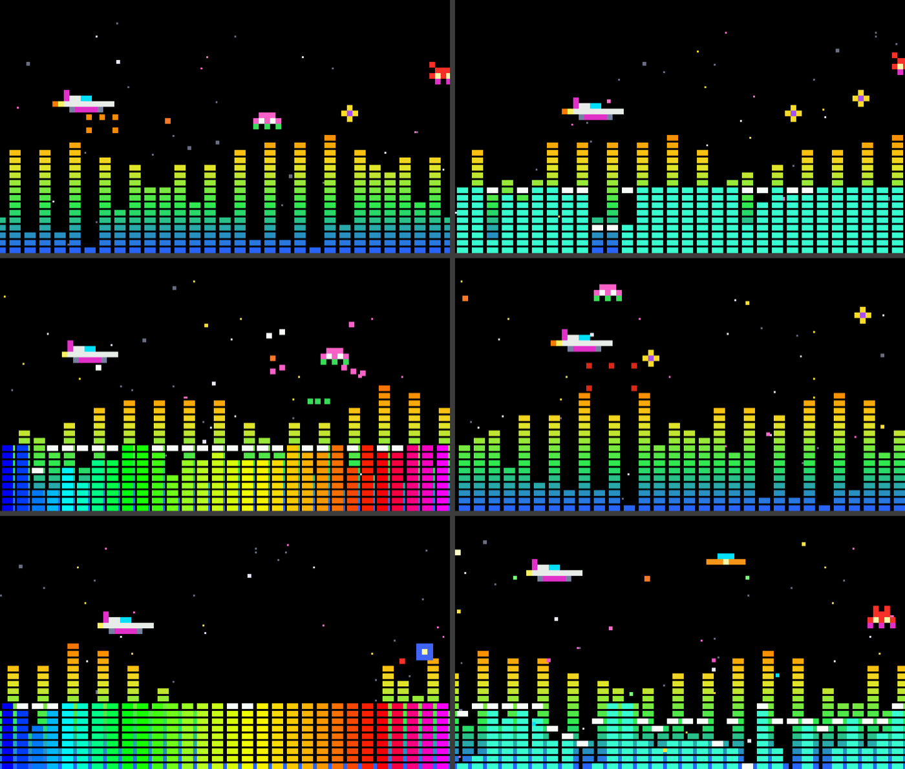
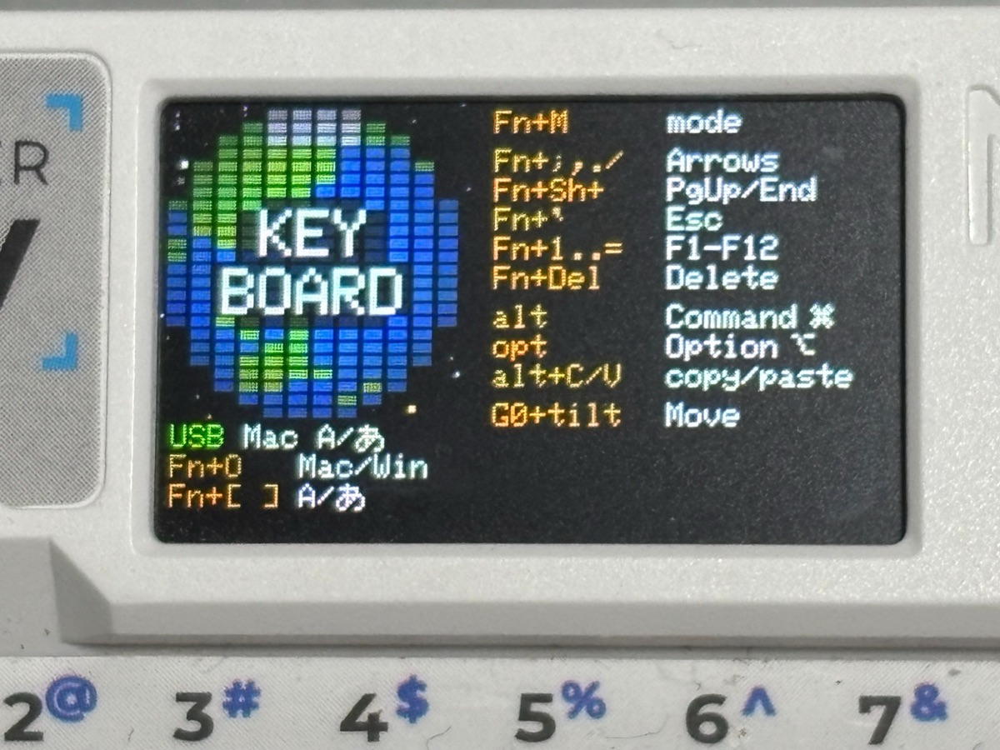
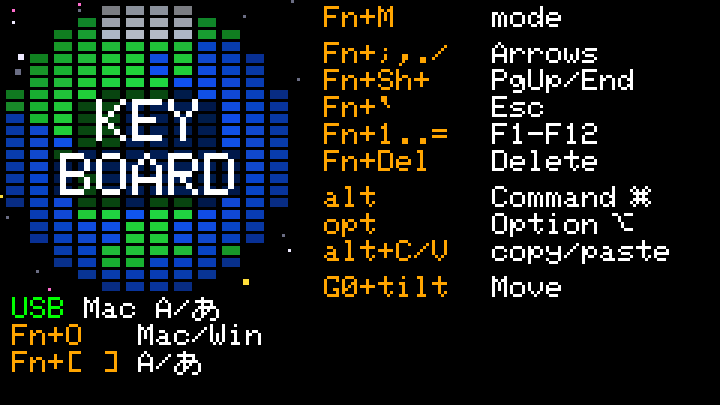
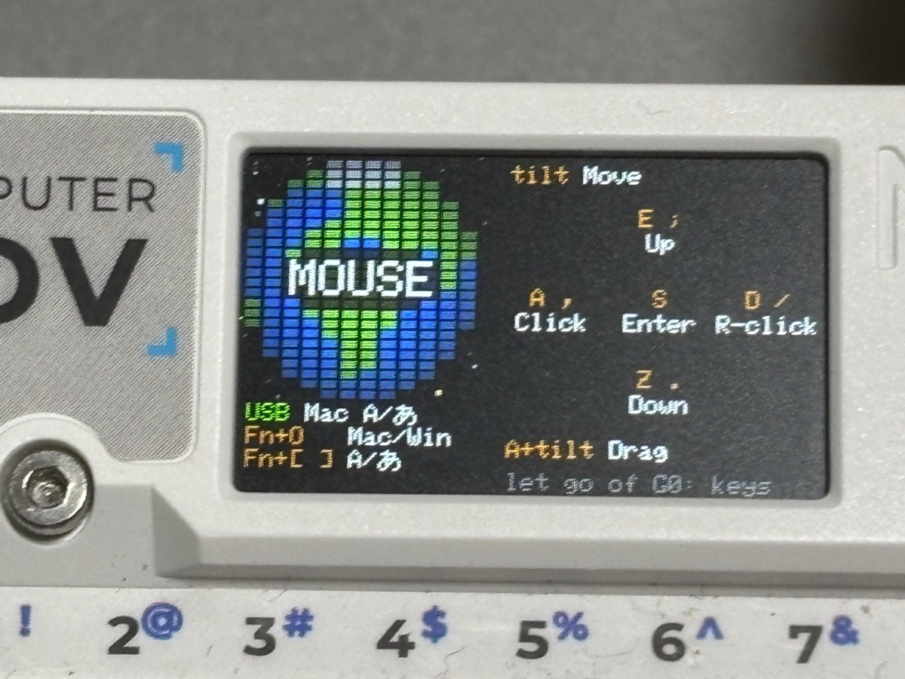
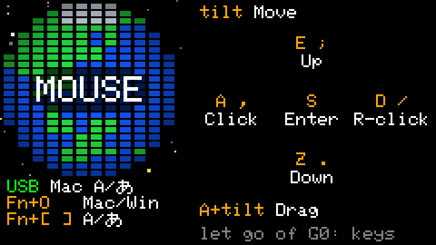

# KeySpeakerの画面

[English](SCREENS.md)

Cardputer ADVの画面（240×135px）に何が出るかのまとめ。S5-13（2026-11-01）の時点。それぞれの決定の詳しい内容と経緯は、[`DESIGN_JA.md`](DESIGN_JA.md) の8.3〜8.3.2にある。下の見た目の多くは利用者のアイデアで、「（利用者の案）」と書いている。

写真は、S5-13を動かしている実機。ほかの絵はパソコンの上で、開発中の試し描きと見本から描いたので、細かいところは今の版と違うことがある。写真では写しきれないもの（flight modeのいくつもの場面、くっきりした文字）を見せるために残している。

## 共通の決まり

- **色**：キーはオレンジ、意味は白。状態は、使えるときは緑、待っているときは黄色、問題があるときは赤。案内の文字はうす暗い灰色。
- **ブロック**：地球、地形、グラフィックイコライザーは、どれも同じ6×3pxのブロック（横8px・縦4px間隔）で描く。画面どうしが同じ仲間に見えるように（利用者の判断）。
- **星**：flight modeとkeyboard modeは、同じ星空を使う。黒い空に、白を中心に黄色とピンクの星。白い星のいくつかはまたたく。
- **文字**：Cardputerの内蔵フォント。内蔵フォントにない「あ」は、ヒラギノから作ったドット絵で描く。

## モード

`Fn+M` を押すたびに、**measure mode（計測）→ flight mode（フライト）→ keyboard mode（キーボード）** の順に変わる（ヘルプ画面と同じ呼び方）。最後に使ったモードを覚えている。USBがないときは、まずキーボード画面が出て、`Fn+M` でほかの画面に動ける（S10-7）。マイク入力（`Fn+I`）のときは、最初から動ける。

## 起動画面と、休んでいるときのエンブレム

- 画面いっぱいのスピーカーの網目に、かりポムの金属のエンブレム。起動のときに2秒出す（キーを押せば飛ばせる）。モードには入れない。たまに見るから楽しい。
- 網は、丸い穴の金属の網（パンチングメタル）。スピーカーに見えるように（見本を見て利用者が決定、S5-13）。
- 起動のときは、エンブレムの下に大きく白い「KeySpeaker」を、暗い影つきで出す（利用者の案、S5-13）。
- エンブレムは元の8割の大きさで、本物のスピーカーのように網目を主役にする。色はスピーカーのバッジらしい銀色（利用者の判断、S2-8）。
- 休んでいるときは、下の網を暗くして、`h HELP  Fn+M KEYBOARD` と出す（キーはオレンジ）。起動のときは出さない。USBがまだ立ち上がる途中で、そのキーがまだ効かないため（S5-13）。
- **休んでいるとき**：measure modeで、キー操作も音もない状態が1分続くと、エンブレムに戻る（休んでいるスピーカーの顔）。キーを押すまでそのままで、そのキーは画面を戻すだけ。flight modeは眺めるための画面なので、そのまま（S5-14）。
- **震える**：大きな音に合わせて、エンブレムが1ドット（とくに大きいときは2ドット）跳ねて、0.1秒で元に戻る。スピーカーのコーンのように（利用者の案、S2-7）。休んでいたスピーカーが、音楽が鳴り出すと震え出す。

## measure mode（計測）

S0からある計測の画面。スピーカーがどう動いているかを確かめるために残している。

- 上：オレンジで `KeySpeaker`、右上に版の名前（たとえば `S5-13`）。
- USBの状態：音が流れているときは緑、つながっているが音がないときは黄色、つながっていないときは赤。
- バッファーの棒、時計のずれの補正、回数のカウンター（音切れは赤）、音量、入ってくる音と出ていく音のレベルメーター。
- 下にうす暗く：`[ ]\ vol  spc play  v view  h help`。

## flight mode（フライト）

音楽を流しながら眺めるスクリーンセーバー。ゲームではない（点数もなく、負けもない）。

*動いているところ（3秒）。少し前の版で撮ったので、上に状態の行が出ている。*

- 音楽の大きさが地形になる。LEDのレベルメーターのように、下の青から緑、黄、オレンジ、上の赤へ色が変わり、左へ流れる。
- その上を小さな戦闘機（80年代はじめのアーケードゲーム風の、オリジナルのドット絵）が飛び、レーザーを撃ち、爆弾を落として地形に小さな穴をあける。音楽の拍に合わせて6種類の害のない標的が現れ（無音のときも6秒に1体。S5-15）、戦闘機が撃つと色とりどりの火花になって消える。標的もときどき撃ち返すが、当たっても戦闘機のシールドが一瞬光るだけ。
- 音楽が鳴っているあいだ（音が約3秒続いてから）、ときどきスペースインベーダーの筐体に描かれていたモンスター（黒と赤、左から光が当たり、黄色く光る目、69×90px）が右から地形の奥を歩いてきて、爪のある手を一番手前に伸ばして戦闘機をつかもうとする。戦闘機はすっと避け、手は空振りし、モンスターは腕を引いて歩き去る（S9-1。先にWEB版で形と動きを作った）。訪問のたびに、ゴリラ、イカ、タコのどれかが、3分の1ずつで来る。イカ（S11-1）は、同じ大きさのスペースインベーダーのイカで、尖った頭に、つり目と小さなへの字の口があり、その下の7本の触手が横に並んで垂れ、地面に寝そべる。ふわりと浮かんで進み、戦闘機が通り過ぎる前と、通り過ぎたあとに、戦闘機側の2本の触手（ときどき反対側の2本も）を戦闘機のほうへ伸ばす。タコ（S15-1）は、背の高い卵形の頭に、頭の下のほうの小さなつり目が2つあり、細い首の下で8本の触手が束になって垂れ、地面に左右へ長く寝そべる（外側の2本は先が反り上がる）。手の伸ばし方はイカと同じ。
- サーチライト（S11-2）：厳戒態勢の街。地面に、最大3つ、小さな基地（明るいグレーの4マスのT字と、上に黄色いランプ）が立ち、地形と一緒に右から左へ流れて、細い光の筋で空を掃く。光は、モンスターの体の中心線と、戦闘機のところで止まる。音楽が鳴っているときだけ、10〜35秒に1つ現れて、画面には約6割の時間、出ている。
- 壊れかけた街（S14-1）：ときどき3〜5棟のビルが地形と一緒に流れてくる（音には反応しない）。角がシールドのように欠け、黒い出入口があり、ときどき火が出る。屋上や窓で小さな人が手を振って助けを求め、戦闘機は近くの人のところへ飛んで、重なって助ける（小さな光が出るだけで、得点はない）。入口から1〜3人が一度に走り出て、戦闘機を追いかけて手を振ることもある。窓から手を振る人がいるビルの屋上には、人は立たない（S15-1。1つのビルに手を振る人は1人まで）。ビルはモンスターの腕より前、戦闘機はビルより前、腕は戦闘機より前で、全部イコライザーより後ろ。モンスターは20回に1回、ショッキングピンクで現れる。
- メテオゾーン（S13-1）：音楽が鳴っていると数分おきに、地形が低く沈み、星が流れ、隕石が右から左へ飛ぶあいだ、戦闘機がそれをかいくぐる。まれに（5回に1回ほど、S15-1）、ゾーンの間ずっと、画面の横幅ほどの長さのくさび形の大型戦艦がゆっくり空を横切る（隕石より奥）。戦闘機をねらって、緑の光弾を2〜3発ずつまとめて撃ち、戦闘機はそれをすっとよける（当たってもシールドが光るだけ）。大きな隕石が当たると、煙が出て、最後は火を噴くが、飛び続ける。1回の通過で1度、画面の中ほどまで来ると、下側が一瞬赤く光り、12発のミサイルが扇形に飛び出して、煙を引きながら戦闘機のほうへ曲がる（S15-2）。
- ときどき、昔のオーディオのようなグラフィックイコライザーが地形の手前にせり上がる。30本の帯と、ゆっくり落ちるピークの点。蛍光表示管の水色か、かりポムの色。見せ方は1分ごとに入れ替わる。
- ふだんはほかに何も出さない。問題があるときだけ、上に1行出す（赤の `not connected`、黄色の `MUTE`、赤の音切れの回数）。地形を主役にする（利用者の判断、S5-13）。

## ヘルプ画面

- measure modeとflight modeで、`h`（または役目のないキー）で開く。スピーカーと再生のキーの一覧で、キーはオレンジ、意味は白（利用者の案。2秒で消える案内より読みやすい）。
- 開いたままでも役目のあるキーは働くので、見ながら試せる。すべてのキーを相手に送るキーボードモードには出さない。

## キーボード画面

わざと静かな画面にしている。flight modeがにぎやかなので、こちらは落ち着いた画面。キーを押しても光らせない。

  
  

*左：実機の写真。右：パソコンで描いた絵。*

**地球（左上、約96px角）**

- 12×24のブロック。海は青、陸は緑、極地は白で、縁に向かって暗くする。北緯20度から見た姿。陸地は、ブロックの粗さに合わせた手作りの粗い地図。
- 1分で1周、本物の地球と同じく陸地が左から右へ流れる。起動したときは日本が正面。flight modeの「地球防衛軍」とつながるように。
- 地球の上に、大きな白い **KEY BOARD**（利用者の案）。文字の後ろだけ、地球をブロックごと3分の1の明るさに暗くする。`KEY` の後ろは6ブロック、`BOARD` の後ろは8ブロックの幅で、`KEY` の両脇の角は明るいまま残る（利用者の案、S2-12）。`KEY` の上と `BOARD` の下の外側の角のブロックは外して、暗い部分の角を丸く見せる（利用者の案、S2.5-5）。

**地球の下（行の間は9px）**

- 接続、OSプロファイル、入力：たとえば `USB Mac A/あ`。接続は、使えるときは緑の `USB` か `BLE`、パソコンを待っている間は黄色の `BLE wait`。`A/あ` はいつも両方出し、最後に `Fn+[` / `Fn+]` で切り替えたほうをオレンジにする（Macのメニューバーと同じ見せ方。Macは入力の状態を教えてくれないので、起動したときは両方とも白）。
- `Fn+O Mac/Win` と `Fn+[ ] A/あ` を、それぞれが変えるものの近くに出す（利用者の案）。
- USBがないとき：左下に `Off+Reset to USB`。USBに戻す方法（5.3）。

**右側（行の間は9px）**

- 右上に `Fn+M mode`。全部のモードで使うキーなので、ここに置く（利用者の案。S10-7でUSBがなくても出す）。その下に `Fn+I USB/MIC`（S10-8）。
- マイク入力のあいだは、左下の隅、接続の行のすぐ上に、緑の `MIC`（丸い地球が空けている場所。S10-9）。その下の緑の `USB` は、ケーブルがつながっていることだけを表す。
- キーボードモードだけのキーの早見表：矢印、PgUp/End、Esc、F1〜F12、Delete、選んだOSでの `alt` / `opt` の役目、コピー・貼り付け、`G0+tilt Move`。
- CommandとOptionの横に、7×7pxのドット絵の印。Macでは⌘と⌥、WindowsではWinの横に4つの窓（Windowsのロゴそのものではない）（利用者の案、S2-11）。

**G0を押している間（エアマウス）**

  
  

*左：実機の写真。右：パソコンで描いた絵。*

- 地球の文字が **MOUSE** に変わり（同じように後ろを暗くし、四隅のブロックを外す）、右側がすぐにマウスのキーに変わる。G0を離すとキーボードに戻る（利用者の案、S2.5-7）。
- キーは、`S` のまわりの `E` `Z` `A` `D` と同じ十字に並べる。上がUp、下がDown、左がClick、右がR-click、真ん中がEnter（利用者の案、S2.5-8）。十字の上に `tilt Move`、下に `A+tilt Drag` と `let go of G0: keys`。

## まだ作っていないもの

- BLEでパソコンを待っている間は地球を灰色にし、つながったら色を付ける（`DESIGN_JA.md` 8.3の予定）。今の版では地球は色付きのままで、代わりに黄色の `BLE wait` で知らせている。
- S7（全体をレトロ機器風にする）はまだ残っている。ただ、上の画面で、すでにかなりそれに近づいている。
