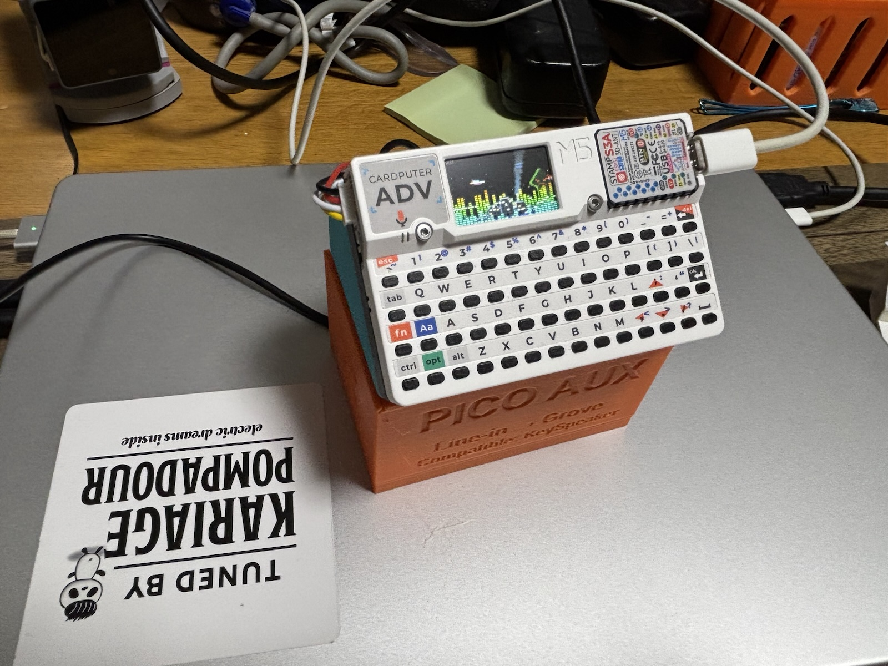

# Box for the Pico AUX unit

- `pico-aux-case.stl`: the case (wall 2 mm). Two holes underneath, in the same places as the Cardputer's back holes, so the box also sits on a Media-Jog base (second version, 2026-11-14). Text is engraved 0.5 mm deep on both long faces, and the image character of Kariagepompadour on both short faces.
- `pico-aux-lid.stl`: the lid. Two pegs on top fit the back holes of the Cardputer ADV. The face the pegs stand on also has an engraved picture (0.5 mm deep): the image character of Kariagepompadour. It is hidden when the Cardputer sits on the lid.
- `pico-aux-stand.stl`: an optional stand (new on 2026-11-14), not needed: without it the Cardputer sits flat on the lid. It only makes the screen easier to see. It goes on the two lid pegs, and the Cardputer goes on its two sloped-face pegs, so the Cardputer leans back at 37 degrees.

Printed on a Bambu Lab A1 mini (0.4 mm nozzle). The author reports that the Pico 2, the PCM1808 board and the mini breadboard fit their pins and holes exactly, and that the Cardputer ADV snaps onto the two lid pegs so firmly that lifting the Cardputer lifts the whole box (2026-11-09). Details and what was measured: [AUX_PICO2_BOX.md](../../docs/AUX_PICO2_BOX.md). The files fall under this repository's [LICENSE](../../LICENSE).

---

# Pico AUX ユニットの箱

- `pico-aux-case.stl`: 箱の本体(壁 2 mm)。底に、Cardputer の背面の穴と同じ位置に穴が 2 つあり、Media-Jog の台座にも差し込めます(第 2 版、2026-11-14)。長い 2 つの側面に、深さ 0.5 mm の文字を、短い 2 つの側面に、Kariagepompadour のイメージキャラクターを彫ってあります。
- `pico-aux-lid.stl`: 蓋。蓋の上の突起 2 本が、Cardputer ADV の裏の穴にはまります。突起が立っている面には、深さ 0.5 mm の絵も彫ってあります。Kariagepompadour のイメージキャラクターです。Cardputer を載せると、隠れます。
- `pico-aux-stand.stl`: おまけのスタンド(2026-11-14 に追加)。なくても大丈夫です。なければ Cardputer は蓋の上に平らにのります。画面を見やすくするだけのものです。蓋の突起 2 本にはめ、斜めの面の突起 2 本に Cardputer をはめると、Cardputer が 37 度傾きます。

Bambu Lab A1 mini(ノズル 0.4 mm)で印刷しました。Pico 2、PCM1808 基板、ミニブレッドボードが、ピンや穴にぴったりはまり、Cardputer ADV も蓋の突起にしっかりはまり、Cardputer を持ち上げると箱ごと上がると、作者が報告しています(2026-11-09)。詳細と、測ったこと: [AUX_PICO2_BOX_JA.md](../../docs/AUX_PICO2_BOX_JA.md)。ファイルには、このリポジトリの [LICENSE](../../LICENSE) が適用されます。
